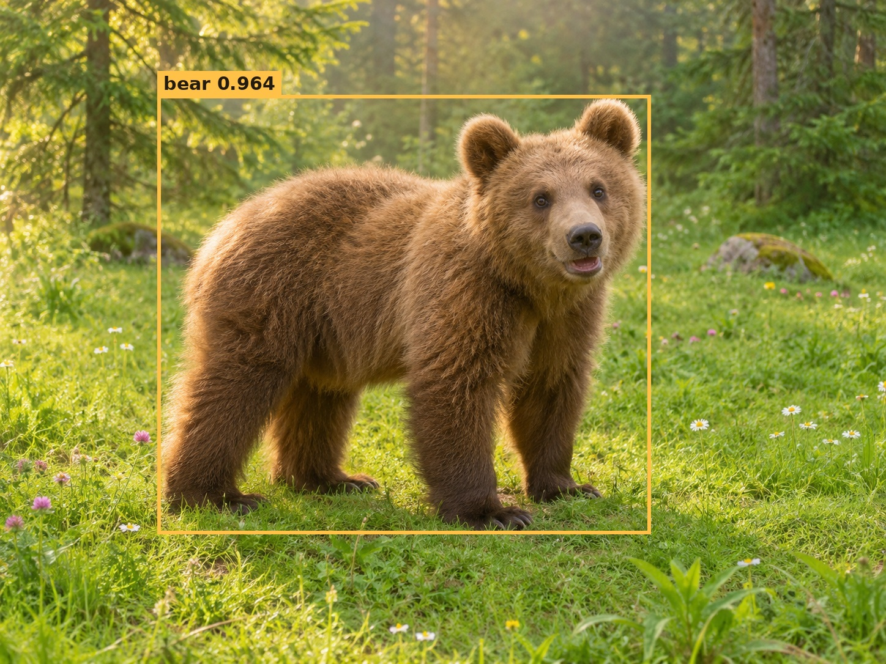

# 🐻 Bear Detector

[English](README.md) | [简体中文](README.zh-CN.md)

**A little heavy, just like a bear.** The name comes from the author’s love of bears—and the model’s rather substantial size. Bear Detector is a general multi-class detector, not a bear-only model.



The image is AI-generated; the box and **0.9637 confidence** are actual predictions from **Base epoch41 EMA**, PyTorch CPU FP32 at640. [Raw prediction and checkpoint hash](assets/bear-inference.json). This is an illustration, not a benchmark.

## A personal note

This personal repository is also a keepsake of my seven years in computer vision. I can’t say I worked especially hard, but they were seven years of my life. I hope that, in time, I will find a goal in life.

— xjn0412

## The model

A fixed-resolution object detector combining a **DINOv3-pretrained ConvNeXt CNN**, two deep context-attention blocks, a convolutional multiscale neck and a six-layer DEIMv2 query decoder. Three sizes: Tiny, Small and Base. This is a research integration derived from **DEIMv2 / DEIM / D-FINE / RT-DETR**, with the changes documented below; it is not an independently invented decoder.

**Status:** research preview for NVIDIA GPUs. Includes arbitrary-class COCO/YOLO fine-tuning, PyTorch image inference, fixed-shape ONNX/TensorRT export, and same-checkpoint accuracy comparison. **No 65 AP claim.** Source and instructions are included; trained detector weight downloads are not included in this initial code release. You can initialize from the public DINOv3 backbone and train your own detector, or supply a compatible detector checkpoint.

**License:** upstream DEIMv2 code is non-commercial. Read [LICENSE.md](LICENSE.md) and [THIRD_PARTY.md](THIRD_PARTY.md); DINOv3 weights have separate terms. This repository does not grant commercial deployment rights.

Parameters below use **M = one million parameters**.

## Measured results

Full COCO val2017, 5,000 images, 640×640, EMA weights, single-scale PyTorch validation:

| Model | Total parameters (80 classes) | Backbone parameters | Selected epoch | mAP50:95 |
|---|---:|---:|---:|---:|
| Base | 112.11M | 87.56M | 41 | **58.9306** |
| Small | 73.68M | 49.45M | 57 | **57.8987** |
| Tiny | 52.05M | 27.82M | — | Not measured |

Snapshot: 2026-11-12. Base and Small were stopped by the author at completed epochs56 and68; Tiny is now training. These are selected checkpoints from repaired runs, not completed, uninterrupted benchmark reproductions. Base resumed from epoch20 and Small from epoch30 after numerical repairs. Architecture stayed fixed; the repaired runtime keeps the entire decoder FP32. These results do **not** establish a controlled FP16-versus-BF16 comparison. Detector supervision used COCO train2017; the pretrained DINOv3 backbone used external LVD-1689M pretraining, so this is **not all-data COCO-only training** and is not zero-shot COCO detection.

Same **Base epoch41 EMA** checkpoint, fixed 1,000-image coverage-stratified COCO val subset, RTX 5090:

| Inference backend | Subset mAP50:95 | GPU mean latency | FPS |
|---|---:|---:|---:|
| PyTorch FP32 | 59.4238 | 19.4644 ms | 51.38 |
| PyTorch FP16 bulk + FP32 decoder | 59.4149 | 19.1562 ms | 52.20 |
| TensorRT FP16 bulk + FP32 decoder | 59.3778 | 4.0203 ms | 248.74 |

Batch1, 640, no CUDA Graph; includes top-300 postprocessing, excludes image preprocessing/host transfers. TensorRT includes device-buffer copies. **Subset AP is not full COCO AP.** Full-set TensorRT parity and Small/Tiny inference speed have not been validated. [Benchmark protocol and evidence](docs/BENCHMARKS.md).

## Start here

1. [Install and run the offline smoke test](docs/INSTALL.md).
2. [Architecture and numerical policy](docs/ARCHITECTURE.md).
3. [Fine-tune on your classes, or initialize from a public backbone](docs/FINETUNE.md).
4. [Run PyTorch inference](docs/INFERENCE.md).
5. [Export and check TensorRT accuracy](docs/EXPORT.md).
6. [What was actually verified](docs/VERIFICATION.md).

```bash
# From the repository root, after installation:
python tests/test_classes.py
python tests/test_sampling.py
python tools/initialize.py --config configs/T.yml --random-init --output weights/smoke-initial.pt
python tools/make_smoke_data.py --output data/smoke
python tools/prepare_finetune.py --config configs/T.yml --checkpoint weights/smoke-initial.pt \
  --train-json data/smoke/train.json --val-json data/smoke/val.json \
  --train-images data/smoke/images --val-images data/smoke/images \
  --output runs/smoke --epochs 2 --batch 2
python tools/predict.py --config runs/smoke/config.yml --checkpoint runs/smoke/initial.pth \
  --classes runs/smoke/classes.json --image data/smoke/images/4.jpg \
  --device cpu --output results/smoke-prediction.json
```

This checks wiring with random weights and synthetic rectangles. It is **not** a trained detector or meaningful accuracy result. Output directories must not already exist; use a new name when repeating preparation.

## YOLO or COCO annotations

COCO JSON uses the four explicit dataset arguments in the fine-tuning guide. For YOLO detection text labels, use a dataset YAML directly:

```bash
python tools/prepare_finetune.py --config configs/T.yml --checkpoint weights/t_initial.pt \
  --data data/my_dataset/data.yaml --output runs/my_yolo_dataset --epochs 30 --batch 8
python tools/train_custom.py --run runs/my_yolo_dataset
```

The preparation tool converts YOLO annotations to the same internal COCO pipeline, retaining class names. It supports directories and text image lists, normalized `class cx cy w h`, background images, and checks for invalid labels and train/validation overlap. It does not require Ultralytics. Detection only: segmentation/pose/OBB labels are rejected. [Detailed YOLO/COCO instructions](docs/FINETUNE.md).

## Main design choices

- ConvNeXt T/S/B pyramid at strides 4, 8, 16, 32; no ViT backbone in these models.
- Two six-head context blocks only at stride32: 20×20 = 400 tokens.
- Cheap stride4 detail branch feeds stride8 features; there is no stride4 decoder memory level.
- Three 256-channel neck outputs, six query-decoder layers, 300 queries.
- FP16 autocast for backbone/context/neck; **entire decoder, floating predictions, matching and losses in FP32**. FP32 master parameters/optimizer and dynamic GradScaler. Do not call `model.half()`.
- Fine-tuning resets every class head and denoising class embedding, including when the old and new class counts happen to match. Resume is a separate operation.
- TensorRT export uses explicit bilinear GatherElements sampling instead of native ONNX GridSample, which failed our TensorRT accuracy checks.

## Acknowledgments

[DEIMv2](https://github.com/Intellindust-AI-Lab/DEIMv2), [DEIM](https://github.com/Intellindust-AI-Lab/DEIM), [D-FINE](https://github.com/Peterande/D-FINE), [RT-DETR](https://github.com/lyuwenyu/RT-DETR), [DINOv3](https://github.com/facebookresearch/dinov3), and [timm](https://github.com/huggingface/pytorch-image-models). Original notices are retained in `source/`.

[Epoch-by-epoch validation history](docs/TRAINING_HISTORY.md)

[Comparison with related detectors](docs/COMPARISON.md): published AP/parameter references, with pretraining and speed-comparison caveats.

[Weight formats and smaller download packages](docs/WEIGHTS.md).
