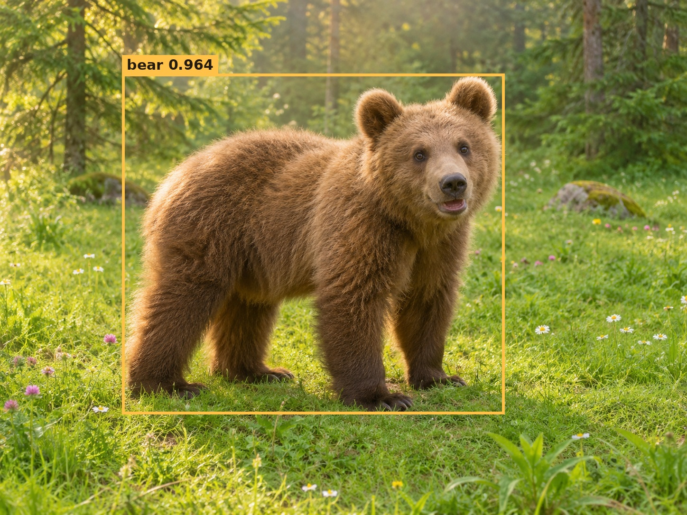

# 🐻 Bear Detector · 熊熊检测器

[English](README.md) | [简体中文](README.zh-CN.md) · [文档](docs/README.md) · [权重](https://github.com/xjn0412/bear-detector/releases) · [Docker](docs/getting-started/DOCKER.zh-CN.md)

**有一点重，就像熊一样。** 作者喜欢熊，而检测器也确实有点“大块头”，于是有了这个名字。它是通用多类别检测器，并不只检测熊。

**训练已完成（2026-11-14）：** Tiny、Small、Base、Large最佳EMA权重均可下载。Tiny / Base / Large分别完成68 / 52 / 44轮；Small由作者在68轮停止。[训练策略](docs/benchmarks/TRAINING_POLICY.md)。



图片由AI生成；框与**0.9637置信度**来自真实**Base第41轮EMA**，PyTorch CPU FP32、640输入。[原始结果与权重哈希](assets/bear-inference.json)。这是展示图片，不是精度基准。

## 640输入模型比较

COCO val2017框AP50:95。**Bear为本项目实测，其他为作者发布结果，本仓库未复测。** 预训练数据、训练过程及参数统计口径不同。

| 模型 | 参数量 | AP50:95 | 来源 / 预训练说明 |
|---|---:|---:|---|
| Bear-T | 52.05M | **56.4597** | 本项目全量验证；EMA第58轮 |
| Bear-S | 73.68M | **57.8987** | 本项目全量验证；EMA第57轮 |
| Bear-B | 112.11M | **59.0008** | 本项目全量验证；EMA第42轮 |
| Bear-L | 221.40M | **60.0728** | 本项目全量验证；EMA第24轮 |
| [DEIMv2-X](https://github.com/Intellindust-AI-Lab/DEIMv2) | 50.3M | 57.8 | 官方DINOv3检测器 |
| [D-FINE-X](https://github.com/Peterande/D-FINE) | 62M | 55.8 | 官方COCO结果 |
| D-FINE-X，Objects365→COCO | 62M | 59.3 | 额外检测预训练 |
| [RT-DETRv2-X](https://github.com/lyuwenyu/RT-DETR) | 76M | 54.3 | 官方COCO结果 |
| [YOLO26-X](https://docs.ultralytics.com/models/yolo26/) | 55.7M | 57.5 | 默认NMS检测头；Objects365预训练；融合部署参数量 |

Bear模型明显更重，此表**不能证明精度与延迟权衡更好**。本项目RTX5090测速与官方T4测速分开列示。[完整比较与来源说明](docs/benchmarks/COMPARISON.zh-CN.md)。

## 模型与下载

**M表示百万参数。** 所有下载统一为原始FP32 EMA的无损gzip包；先解压再加载，不包含optimizer/scaler续训状态。

| 模型 | 参数量 | AP50:95 | 最佳轮次 | 下载 |
|---|---:|---:|---:|---|
| Tiny | 52.05M | 56.4597 | 58 | [EMA · 193.77 MB](https://github.com/xjn0412/bear-detector/releases/download/v0.2.0-tiny/bear-t-coco-ema.pt.gz) |
| Small | 73.68M | 57.8987 | 57 | [EMA · 274.17 MB](https://github.com/xjn0412/bear-detector/releases/download/v0.1.0-weights/bear-s-coco-ema.pt.gz) |
| Base | 112.11M | 59.0008 | 42 | [EMA · 416.91 MB](https://github.com/xjn0412/bear-detector/releases/download/v0.2.1-base/bear-b-coco-ema.pt.gz) |
| Large | 221.40M | 60.0728 | 24 | [EMA · 822.79 MB](https://github.com/xjn0412/bear-detector/releases/download/v0.3.0-large/bear-l-coco-ema.pt.gz) |

[SHA256 & 使用方法](docs/models/WEIGHTS.zh-CN.md) · [Model zoo](docs/models/MODEL_ZOO.zh-CN.md) · [Epoch history](docs/benchmarks/TRAINING_HISTORY.md)

检测监督仅使用COCO train2017，但DINOv3骨干使用外部LVD-1689M预训练，因此不是所有预训练数据都仅来自COCO，也不是COCO零样本检测。

## 快速开始

公开NVIDIA微调镜像，无需登录：

```bash
docker pull ghcr.io/xjn0412/bear-detector:finetune-cu130
```

| 任务 | 指南 |
|---|---|
| Docker微调、持久化挂载与Small初始化 | [Docker指南](docs/getting-started/DOCKER.zh-CN.md) |
| 源码安装与离线检查 | [安装](docs/getting-started/INSTALL.zh-CN.md) |
| COCO JSON / YOLO标注、任意正整数类别微调 | [微调](docs/guides/FINETUNE.zh-CN.md) |
| PyTorch预测和验证 | [推理](docs/guides/INFERENCE.zh-CN.md) |
| ONNX/TensorRT导出与精度验证 | [导出](docs/guides/EXPORT.zh-CN.md) |
| 查询命令和目录职责 | [命令索引](docs/reference/TOOLS.md) · [仓库结构](docs/reference/REPOSITORY.md) |

镜像已通过构建、依赖与CPU流程检查；镜像内GPU反向/DDP仍需在目标主机验证。数据和权重单独挂载。[全部文档](docs/README.md) · [验证范围](docs/benchmarks/VERIFICATION.zh-CN.md)。

## 架构

DINOv3预训练**ConvNeXt CNN** → 两个stride32上下文注意力模块 → 卷积多尺度颈部及轻量P2→P3细节分支 → 六层、三尺度DEIMv2查询解码器，300查询，固定640输入。主体FP16；**整个解码器、预测、匹配和损失FP32**。这些配置不使用ViT。[架构指南](docs/models/ARCHITECTURE.zh-CN.md)。

这是基于DEIMv2 / DEIM / D-FINE / RT-DETR的研究集成，不把上游解码器宣称为原创。[训练记录](docs/benchmarks/TRAINING_HISTORY.md) · [基准方法](docs/benchmarks/BENCHMARKS.zh-CN.md) · [验证资料索引](validation/README.md)。

## 写给自己

这个个人仓库，也是我在计算机视觉领域走过七年的一份纪念。说不上多么努力，但那是我人生中的七年。希望未来的我，能找到人生的目标。

—— xjn0412

## 许可与致谢

上游DEIMv2代码仅限**非商业用途**，DINOv3权重另有条款；本仓库不授予商业部署权利。[LICENSE.md](LICENSE.md) · [THIRD_PARTY.md](THIRD_PARTY.md) · [贡献指南](CONTRIBUTING.md)。

感谢DEIMv2、DEIM、D-FINE、RT-DETR、DINOv3和timm；原始声明保留在`source/`和`licenses/`中。
