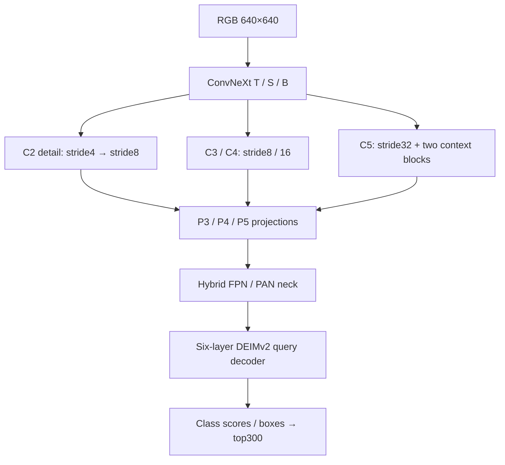

# Architecture

[English](ARCHITECTURE.md) | [简体中文](ARCHITECTURE.zh-CN.md)

The model combines a pretrained convolutional feature pyramid with a query-based transformer detector. ConvNeXt is a CNN; the two deep context blocks and detection decoder use attention. It is not a ViT backbone. The shared head stays the same for Tiny/Small/Base, so backbone changes are interpretable.

| Component | Settings |
|---|---|
| ConvNeXt T stage depths | 3,3,9,3 |
| ConvNeXt S/B stage depths | 3,3,27,3 |
| T/S stage channels | 96,192,384,768 |
| B stage channels | 128,256,512,1024 |
| Context | two blocks, dimension384, 6 heads, 400 tokens, depthwise positional convolution, LayerNorm, SDPA, gated FFN |
| Context insertion | residual scale initialized0.1; only C5 |
| Detail | 64-channel projection, depthwise stride2 convolution, projection256; learnable scale0.1 into P3 |
| Neck | HybridEncoder, hidden256, depth_mult1.37, expansion1.25, CSP2, sum fusion; no extra transformer encoder |
| Decoder | hidden256, 6 layers, 3 levels, sample points3/6/3, 300 queries, 100 denoising queries during training |
| Box regression | reg_max32, distribution refinement; losses inherited from DEIMv2 |
| Input | fixed640×640; direct bilinear resize with ImageNet normalization |

## Source map

- `backbone.py`: custom context blocks, detail path and DINOv3 ConvNeXt integration.
- `configs/T.yml`, `S.yml`, `B.yml`: shared detector configuration and variant selection.
- `source/engine/deim/`: vendored decoder, neck, criterion and postprocessor.
- `runtime.py`: FP32 decoder/criterion, finite-loss guards, dynamic-scaler checks and optimizer/EMA bookkeeping.
- `tools/common.py`: class schema, strict checkpoint transfer and inference precision wrapper.
- `tools/portable_sampling.py`: export-only bilinear sampling implementation.

## Numerical policy

Train with FP32 parameters/optimizer, FP16 autocast backbone/context/neck, entire decoderFP32, FP32 matching/losses and dynamic GradScaler. EMA advances only after an observed optimizer step. An entirely skipped epoch raises an error. Nonfinite losses are never silently replaced with zero. Custom fine-tuning starts GradScaler at1.0; this is a conservative starting scale, not fixed loss scaling.

Earlier experiments overflowed inside decoder gated FFNs and suffered accuracy degradation despite some finite scalar losses. The unified release keeps the complete decoderFP32, rather than assuming FP16-safe training from the presence of a scaler. PyTorch validation uses EMA weights in FP32; separate deployment evaluation checks the FP16-bulk/FP32-decoder path. FP16 training alone does not prove FP16 inference parity.

## Relationship to other detectors

This is a DEIMv2-family hybrid CNN/query detector. Unlike a typical dense YOLO head, final predictions are refined by six query decoder layers and ranked by top-k, without a new NMS stage. Its convolutional multiscale fusion shares broad ideas with FPN/PAN detectors; this does not establish an accuracy or speed advantage over YOLO. No matched YOLO benchmark has been run here.
