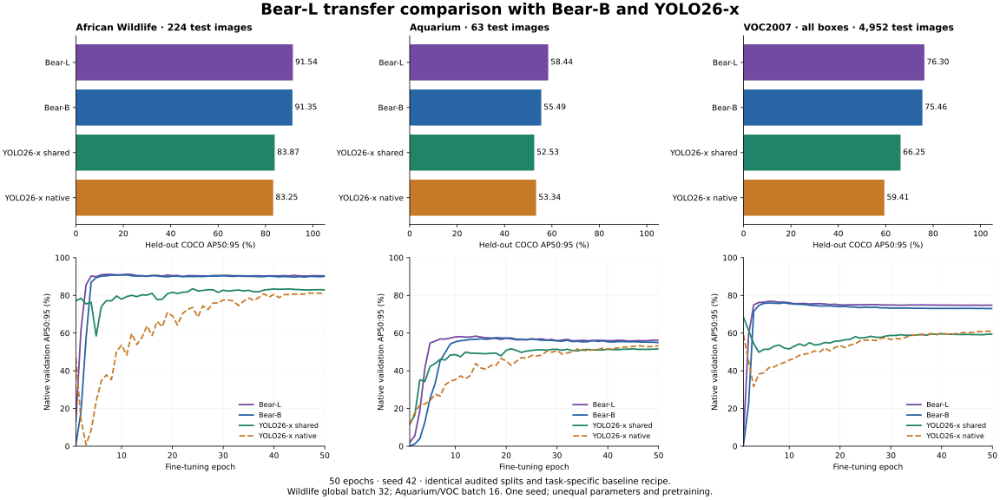

# Bear-L transfer comparison

Status: all three Bear-L fine-tuning runs and common test evaluations complete.

| Dataset | Bear-L | Bear-B | YOLO26-x shared | YOLO26-x default | L minus validation-selected YOLO |
|---|---:|---:|---:|---:|---:|
| African Wildlife | 91.54 | 91.35 | 83.87 | 83.25 | +7.67 |
| Aquarium | 58.44 | 55.49 | 52.53 | 53.34 | +5.10 |
| VOC2007 · all boxes | 76.30 | 75.46 | 66.25 | 59.41 | +10.05 |

All values are percentages; differences are AP points. Validation selects each checkpoint and the YOLO recipe. Test scores do not select recipes or epochs. Bear-L starts from its original COCO FP32 EMA, with fresh class heads. It uses the prior Bear-B task recipe, including global batch32 for Wildlife and16 for Aquarium/VOC, 50 epochs and seed42. The baseline data and predictions are reused unchanged. Both Bear sizes retain FP32 decoder/losses with AMP bulk. Bear-L is substantially larger than Bear-B/YOLO26-x; DINOv3 representation pretraining versus YOLO26 Objects365→COCO and model-specific optimization remain confounders. No architecture-only or efficiency claim follows. VOC difficult boxes are ordinary positives, so this is all-box COCO AP, not official VOC AP. Paired image-bootstrap intervals for Wildlife/Aquarium are in the evidence; they do not measure training-seed uncertainty. An interval crossing zero does not establish a stable AP advantage.

| Dataset | Model | Selected epoch | AP50:95 | AP50 | AP75 | Small AP | Medium AP | Large AP |
|---|---|---:|---:|---:|---:|---:|---:|---:|
| African Wildlife | Bear-L | 11 | 91.54 | 99.56 | 96.51 | — | 78.91 | 92.52 |
| African Wildlife | Bear-B | 11 | 91.35 | 99.51 | 95.71 | — | 78.50 | 92.12 |
| African Wildlife | YOLO26-x shared | 24 | 83.87 | 96.61 | 92.00 | — | 52.28 | 85.27 |
| African Wildlife | YOLO26-x native | 47 | 83.25 | 95.84 | 92.38 | — | 42.72 | 85.20 |
| Aquarium | Bear-L | 14 | 58.44 | 91.10 | 63.43 | 30.66 | 51.51 | 76.90 |
| Aquarium | Bear-B | 18 | 55.49 | 84.34 | 63.10 | 30.36 | 48.96 | 75.67 |
| Aquarium | YOLO26-x shared | 21 | 52.53 | 82.57 | 59.08 | 31.84 | 48.13 | 68.98 |
| Aquarium | YOLO26-x native | 46 | 53.34 | 85.38 | 58.34 | 35.55 | 49.18 | 68.64 |
| VOC2007 · all boxes | Bear-L | 6 | 76.30 | 92.85 | 83.41 | 29.00 | 55.83 | 82.69 |
| VOC2007 · all boxes | Bear-B | 9 | 75.46 | 92.09 | 82.13 | 24.57 | 53.81 | 82.07 |
| VOC2007 · all boxes | YOLO26-x shared | 1 | 66.25 | 84.30 | 73.54 | 18.15 | 42.76 | 72.62 |
| VOC2007 · all boxes | YOLO26-x native | 50 | 59.41 | 78.92 | 65.10 | 12.51 | 34.15 | 66.16 |

[Recorded metrics, per-class AP, intervals, configurations and hashes](../../validation/benchmarks/bear-l-transfer-20261114/). Plain original FP32 `.pt` weights and full optimizer checkpoints are retained on the training host.
