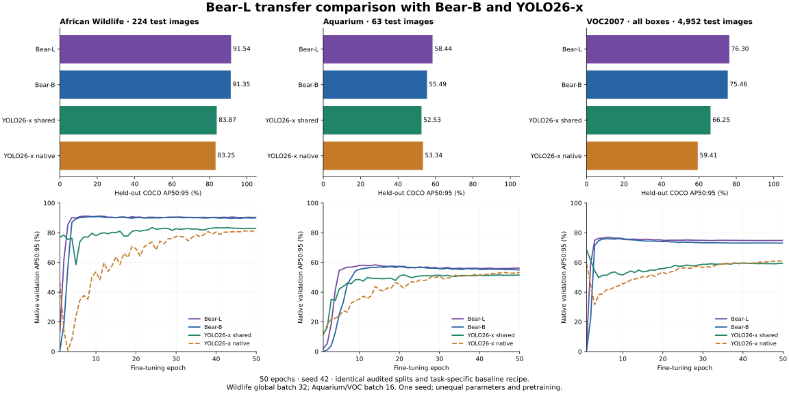

# Bear-L 微调对比

三组 Bear-L 均完成 50 个 epoch，并按验证集选择最佳 EMA，统一测试集计算 COCO AP。

| Dataset | Bear-L | Bear-B | YOLO26-x shared | YOLO26-x default | L minus validation-selected YOLO |
|---|---:|---:|---:|---:|---:|
| African Wildlife | 91.54 | 91.35 | 83.87 | 83.25 | +7.67 |
| Aquarium | 58.44 | 55.49 | 52.53 | 53.34 | +5.10 |
| VOC2007 · all boxes | 76.30 | 75.46 | 66.25 | 59.41 | +10.05 |

以上 AP 为百分数，差值为百分点。YOLO 配方仅按验证集选择。沿用原先三组数据划分和训练配方：African Wildlife 的全局 batch32，Aquarium/VOC 的 batch16；均为640输入、种子42、50个epoch。VOC difficult 均作为普通正样本保留，结果不是官方 VOC AP。Bear-L 从原始 COCO FP32权重重新微调，分类头重新初始化。模型大小、预训练和优化实现不同，不能把差异完全归因于架构。小数据集的配对bootstrap区间见统计文件；区间跨零时不能认定稳定领先。

[详细指标和实验协议](BEAR_L_TRANSFER.md) · [配置、曲线、每类AP及校验信息](../../validation/benchmarks/bear-l-transfer-20261114/)
