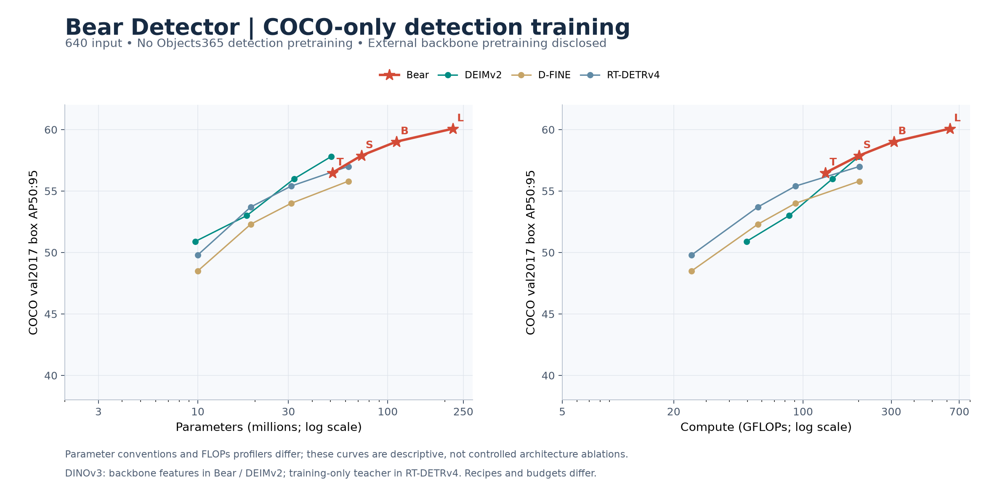
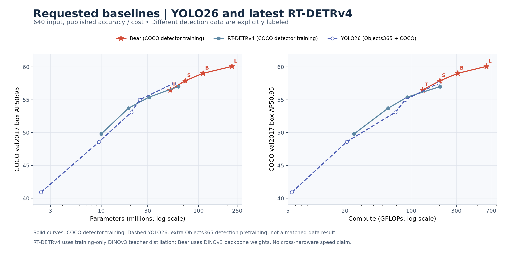
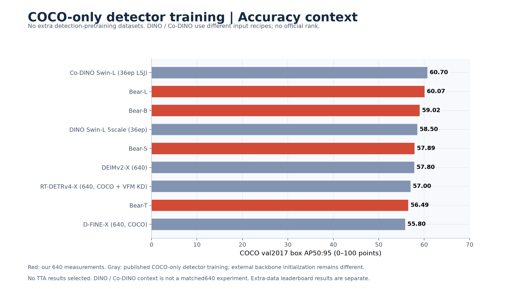
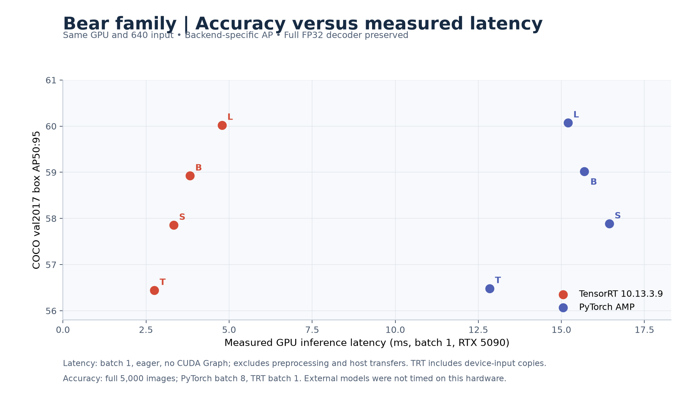

# COCO-only detector training: comparison and analysis

[English](COMPARISON.md) | [简体中文](COMPARISON.zh-CN.md)

**Primary comparison: detection supervision uses COCO train2017 only; no Objects365, OpenImages, or grounding detector-pretraining stage.** All primary model-cost curves use640 input and single-scale evaluation. Snapshot2026-11-14. Bear results are measured on all5,000 COCO val2017 images; external figures are author-reported, not rerun.

“COCO-only” here describes **detector training**, not all data ever used by the backbone. Bear uses externally pretrained DINOv3 ConvNeXt weights. DEIMv2 also uses DINOv3 representations; other families have their own backbone initialization. This is the relevant dataset-controlled comparison for our existing checkpoints. No retraining is needed to relabel their existing COCO-only detection runs.

## Primary graphs and results

| Model | COCO val AP50:95 | Params M¹ | GFLOPs² | Source |
|---|---:|---:|---:|---|
| Bear-T | 56.49 | 51.10 | 132.18 | [Source](https://github.com/xjn0412/bear-detector/blob/main/docs/benchmarks/DEPLOYMENT5090.md) |
| Bear-S | 57.89 | 72.73 | 201.21 | [Source](https://github.com/xjn0412/bear-detector/blob/main/docs/benchmarks/DEPLOYMENT5090.md) |
| Bear-B | 59.02 | 111.16 | 310.75 | [Source](https://github.com/xjn0412/bear-detector/blob/main/docs/benchmarks/DEPLOYMENT5090.md) |
| Bear-L | 60.07 | 220.45 | 622.32 | [Source](https://github.com/xjn0412/bear-detector/blob/main/docs/benchmarks/DEPLOYMENT5090.md) |
| DEIMv2-S | 50.90 | 9.70 | 49.50 | [Source](https://github.com/Intellindust-AI-Lab/DEIMv2#1-model-zoo) |
| DEIMv2-M | 53.00 | 18.10 | 84.10 | [Source](https://github.com/Intellindust-AI-Lab/DEIMv2#1-model-zoo) |
| DEIMv2-L | 56.00 | 32.20 | 144.50 | [Source](https://github.com/Intellindust-AI-Lab/DEIMv2#1-model-zoo) |
| DEIMv2-X | 57.80 | 50.30 | 200.00 | [Source](https://github.com/Intellindust-AI-Lab/DEIMv2#1-model-zoo) |
| D-FINE-S | 48.50 | 10.00 | 25.00 | [Source](https://github.com/Peterande/D-FINE#model-zoo) |
| D-FINE-M | 52.30 | 19.00 | 57.00 | [Source](https://github.com/Peterande/D-FINE#model-zoo) |
| D-FINE-L | 54.00 | 31.00 | 91.00 | [Source](https://github.com/Peterande/D-FINE#model-zoo) |
| D-FINE-X | 55.80 | 62.00 | 202.00 | [Source](https://github.com/Peterande/D-FINE#model-zoo) |
| RT-DETRv4-S | 49.80 | 10.00 | 25.00 | [Source](https://github.com/AIMIA-PKU/RT-DETRv4#-performance) |
| RT-DETRv4-M | 53.70 | 19.00 | 57.00 | [Source](https://github.com/AIMIA-PKU/RT-DETRv4#-performance) |
| RT-DETRv4-L | 55.40 | 31.00 | 91.00 | [Source](https://github.com/AIMIA-PKU/RT-DETRv4#-performance) |
| RT-DETRv4-X | 57.00 | 62.00 | 202.00 | [Source](https://github.com/AIMIA-PKU/RT-DETRv4#-performance) |

¹ Bear deployment counts; full checkpoint counts T/S/B/L are52.05/73.68/112.11/221.40M. External counts retain author conventions. ² FLOPs profilers differ; Bear includes attention products and bilinear sampling. Neither axis establishes same-hardware speed. Bear AP is the current mixed-checkpoint PyTorch AMP result; [historical training AP](TRAINING_HISTORY.md) remains unchanged.

## Requested current baselines: YOLO26 and RT-DETRv4

RT-DETRv4 is the newest release linked by the[official RT-DETR project](https://github.com/lyuwenyu/RT-DETR#-updates); the canonical repository now redirects to[AIMIA-PKU/RT-DETRv4](https://github.com/AIMIA-PKU/RT-DETRv4). The current paper/repository report49.8/53.7/55.4/57.0AP for S/M/L/X. We use these revised values, not older49.7/53.5 figures. Parameter/FLOP counts come from[paper Table1](https://arxiv.org/html/2510.25257v2#S4.T1), excluding the training-only teacher. v2 rows are retained only as historical data, not the current plotted baseline.

YOLO26 is explicitly included here and on the front page. Its released checkpoint's default NMS-head AP is shown; the[official training recipe](https://docs.ultralytics.com/guides/yolo26-training-recipe/) includes150epochs of Objects365 before COCO. No verified official COCO-from-scratch result is substituted or invented. The dashed series is a requested reference, excluded from the COCO-only primary cohort.

| Model | AP50:95 | Params M | GFLOPs | Detector training |
|---|---:|---:|---:|---|
| Bear-T | 56.49 | 51.10 | 132.18 | COCO only |
| Bear-S | 57.89 | 72.73 | 201.21 | COCO only |
| Bear-B | 59.02 | 111.16 | 310.75 | COCO only |
| Bear-L | 60.07 | 220.45 | 622.32 | COCO only |
| YOLO26-n | 40.90 | 2.40 | 5.50 | Objects365 → COCO |
| YOLO26-s | 48.60 | 9.50 | 20.90 | Objects365 → COCO |
| YOLO26-m | 53.10 | 20.40 | 68.40 | Objects365 → COCO |
| YOLO26-l | 55.00 | 24.80 | 86.80 | Objects365 → COCO |
| YOLO26-x | 57.50 | 55.70 | 194.40 | Objects365 → COCO |
| RT-DETRv4-S | 49.80 | 10.00 | 25.00 | COCO only |
| RT-DETRv4-M | 53.70 | 19.00 | 57.00 | COCO only |
| RT-DETRv4-L | 55.40 | 31.00 | 91.00 | COCO only |
| RT-DETRv4-X | 57.00 | 62.00 | 202.00 | COCO only |

Bear-B/L are2.02/3.07AP above current RT-DETRv4-X, at about1.79×/3.56× its reported parameters. Versus YOLO26-x57.5, Bear-B/L are1.52/2.57AP higher, but that comparison includes different detection data. RT-DETRv4's DINOv3 teacher is a training technique, not an Objects365 detector-pretraining stage. Training budgets and feature-transfer methods still differ. External T4 speeds are not compared to our5090 timings.

## Training-regime audit

| Family | Detector training data | Backbone / training distinction |
|---|---|---|
| Bear | COCO train2017 only | DINOv3 ConvNeXt representation pretraining on LVD-1689M; Mosaic/MixUp/Copy-Blend and EMA in released config |
| DEIMv2 COCO rows | COCO only | DINOv3 ViT pretrained/distilled features; own augmentation/loss/schedule |
| D-FINE COCO rows | COCO only | Author backbone initialization and recipe; no Objects365 detector stage in selected rows |
| RT-DETRv4 COCO rows | COCO only | DINOv3 ViT-B/16 teacher distillation (DSI/GAM); teacher is absent at inference |
| YOLO26 / D-FINE O365 | Objects365 → COCO | Supplemental only; excluded from primary graph |
| YOLO27 preview / unverified rows | Not established here | Excluded from primary until detector-training provenance is verified |

Sources: [DEIMv2 COCO model zoo](https://github.com/Intellindust-AI-Lab/DEIMv2#1-model-zoo) and [training paper](https://arxiv.org/abs/2509.20787), [D-FINE's separate COCO / Objects365 tables](https://github.com/Peterande/D-FINE#model-zoo), [Latest RT-DETRv4 results](https://github.com/AIMIA-PKU/RT-DETRv4#-performance) and [paper Table1](https://arxiv.org/html/2510.25257v2#S4.T1), [YOLO26 pretraining recipe](https://docs.ultralytics.com/guides/yolo26-training-recipe/), and our [configs](../../configs/B.yml).

The earlier overview mixed COCO-only detector training with extra detection data. That was unsuitable as the primary comparison. D-FINE-X's correct primary result is**55.8**, not its Objects365-pretrained59.3. YOLO26's released57.5 AP checkpoint also uses Objects365, so it is excluded. YOLO11 is retained only in supplemental context because its complete detector-pretraining provenance was not verified in this audit; this does not assert that it used Objects365.

Dataset matching does not make training techniques identical. Our own configuration already uses augmentation, EMA and DEIM-family training methods. DEIMv2 additionally documents its own feature distillation/Copy-Blend/loss/schedule, and RT-DETRv4 uses DINOv3-teacher distillation. We retain these methods as part of each published system, disclose the differences, and do not attribute the AP difference solely to architecture. A technique-matched comparison would require controlled reruns with equal backbone initialization, schedule, augmentation, loss, seeds and compute budget; those results are not available.

## Corrected performance analysis

**Bear has strong absolute AP among these COCO-only detector-training baselines.** Bear-T56.49 exceeds D-FINE-X55.8 by0.69AP, with51.10M versus62M reported parameters and132.18 versus202GFLOPs. Bear-B59.02 exceeds D-FINE-X by3.22AP and current RT-DETRv4-X57.0 by2.02AP. Bear-L60.07 exceeds them by4.27 and3.07AP respectively. RT-DETRv4-X reports62M deployment parameters; Bear-B/L use about1.79×/3.56× as many. The stronger DINOv3 backbone pretraining is a possible contributor; these are whole-system comparisons, not proof of a better decoder or training algorithm.

**DEIMv2 is the more demanding close reference.** Both systems use COCO detector supervision and DINOv3 features. DEIMv2-X reports57.8AP at50.3M. Bear-T is1.31AP lower at similar parameter count. Bear-S is0.09AP higher with about45% more parameters. Bear-B/L improve by1.22/2.27AP with about2.21×/4.38× parameters. Thus the parameter-efficiency concern remains even after removing Objects365 baselines, but it must be based on this appropriate cohort, not on extra-data models. Different ViT/ConvNeXt backbones and recipes still prevent an architecture-only conclusion.

**Within Bear, Base is a practical accuracy/latency balance and Large gives the highest AP.** Same5090 TensorRT measurements: Base58.92AP/3.82ms versus Large60.02AP/4.79ms; +1.10AP for about25% more latency. Tiny is fastest at2.75ms. External T4/A100 timings do not establish a speedup on5090.

## COCO-only higher-resolution references

[DINO Swin-L 5scale](https://github.com/IDEA-Research/DINO) reports58.5AP without Objects365 or multi-scale test. [Co-DINO Swin-L,36epochs LSJ](https://github.com/Sense-X/Co-DETR#co-detr-with-swin-l) reports60.7AP in its COCO section, distinct from its Objects365-pretrained section. Their input/training recipes differ from Bear's fixed640; they are COCO-only detector-training context, not additional points on the matched640 cost curves. Both also use externally pretrained backbones. No official leaderboard rank is assigned to Bear.

The user-linked [SOTA2 page](https://www.sota2.com/research/sota/object-detection-on-coco-2017-val) combines many regimes. Its extra-data entries remain in a [separate context appendix](COMPARISON_EXTRA_DATA.md); they are not used to judge our primary COCO-only comparison. In particular, the4.53AP gap to Focal-Stable-DINO is a cross-data, cross-resolution numeric gap, not an apples-to-apples deficit.

## Object size and next useful tests

| Bear | AP small | AP medium | AP large |
|---|---:|---:|---:|
| Bear-T | 39.50 | 60.88 | 73.50 |
| Bear-S | 41.03 | 62.93 | 75.52 |
| Bear-B | 42.72 | 63.99 | 75.86 |
| Bear-L | 43.77 | 64.89 | 76.90 |

Small objects are the lowest-AP group within Bear. The earlier small-object gap to Focal-Stable-DINO is confounded by its Objects365 and higher-resolution recipe, so it cannot diagnose an architectural failure. Useful future tests under the same COCO-only detector-data rule are resolution/neck/decoder ablations, and repeated matched-recipe runs. None was launched by this documentation correction.

## Bear's measured latency

Single5090,batch1,640,100warmups,3×300CUDA-event samples,noCUDA Graph; excludes preprocessing/host transfers. TRT includes device-input copies. Accuracy uses fullCOCO,PTbatch8/TRTbatch1,with backend-specificAP. [Full protocol and memory](DEPLOYMENT5090.md).

## Reproduce the figures

[Plotted data, cohort flags and source URLs](../../validation/benchmarks/comparison-20261114/comparison.json). Run`python tools/plot_comparison.py` with matplotlib. The primary graph filters explicit`primary_coco_only`flags and excludes every extra-data/unverified/preview row. Published-system comparison does not equal matched training techniques. Presentation references[Ultralytics GitHub](https://github.com/ultralytics/ultralytics).
