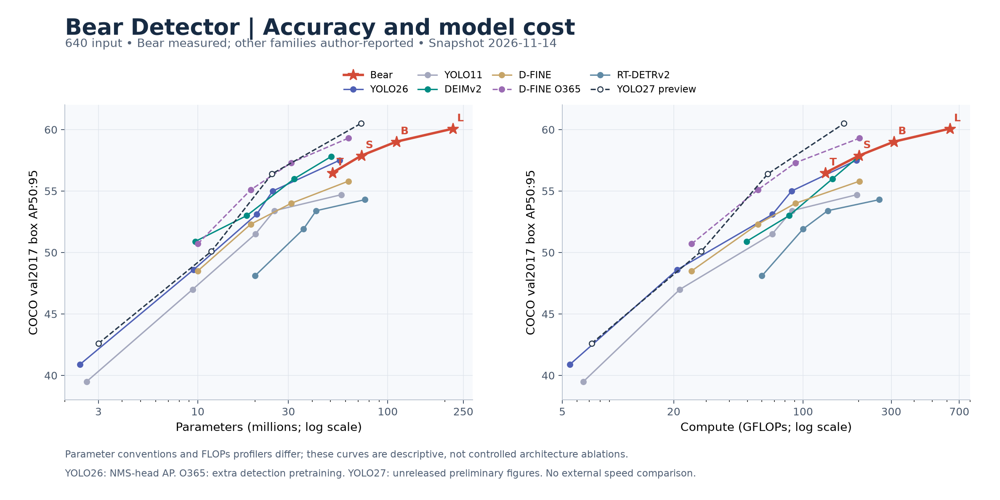
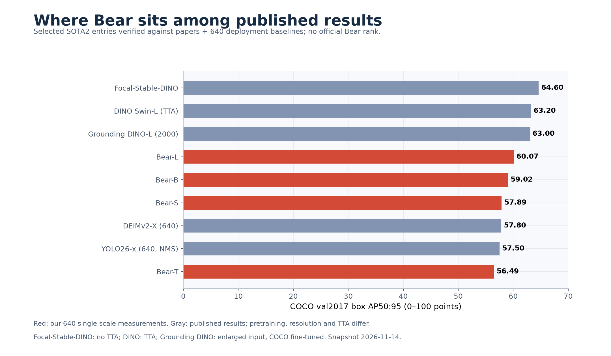
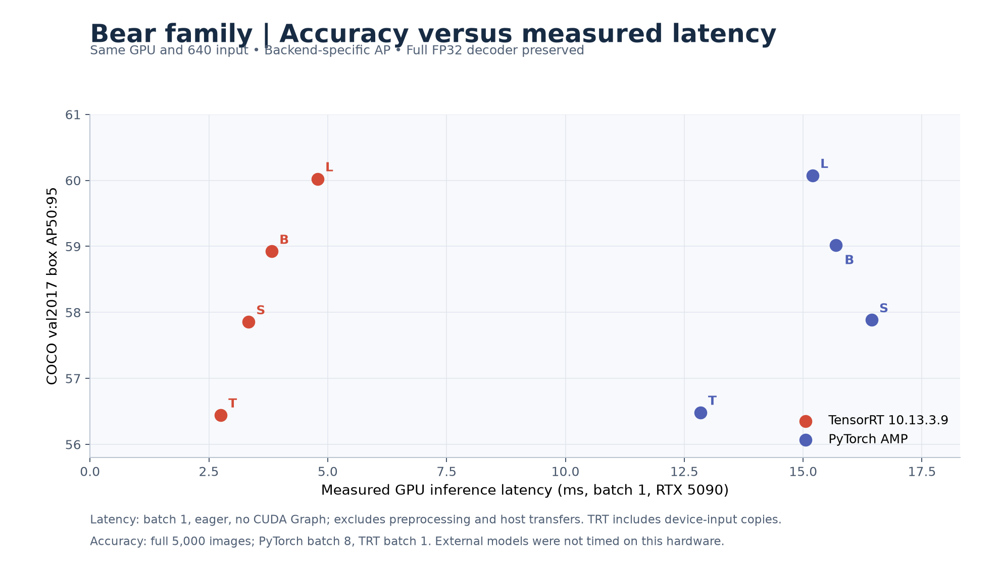

# 模型比较与性能分析

[English](COMPARISON.md) | [简体中文](COMPARISON.zh-CN.md)

资料日期：**2026-11-14**。参考[Ultralytics GitHub](https://github.com/ultralytics/ultralytics)的图表与模型列表组织方式。Bear使用本项目对5,000张COCO val2017的实测结果；其他模型使用作者发布数字，本次没有重新测试。AP均指框AP50:95，按0–100计分。

## 640输入下的精度与模型成本

本节所有模型均为640输入。Bear使用当前混合存储权重的PyTorch AMP结果，精度评测batch8，整个解码器FP32；[历史训练AP](TRAINING_HISTORY.md)保持原样。不同项目中的Tiny/S/L/X名称不代表相同容量。

| Model | AP50:95 | Params M¹ | GFLOPs² | Source |
|---|---:|---:|---:|---|
| Bear-T | 56.49 | 51.10 | 132.18 | [Measured](https://github.com/xjn0412/bear-detector/blob/main/docs/benchmarks/DEPLOYMENT5090.md) |
| Bear-S | 57.89 | 72.73 | 201.21 | [Measured](https://github.com/xjn0412/bear-detector/blob/main/docs/benchmarks/DEPLOYMENT5090.md) |
| Bear-B | 59.02 | 111.16 | 310.75 | [Measured](https://github.com/xjn0412/bear-detector/blob/main/docs/benchmarks/DEPLOYMENT5090.md) |
| Bear-L | 60.07 | 220.45 | 622.32 | [Measured](https://github.com/xjn0412/bear-detector/blob/main/docs/benchmarks/DEPLOYMENT5090.md) |
| YOLO26-n | 40.90 | 2.40 | 5.50 | [YOLO26](https://github.com/ultralytics/ultralytics#models) |
| YOLO26-s | 48.60 | 9.50 | 20.90 | [YOLO26](https://github.com/ultralytics/ultralytics#models) |
| YOLO26-m | 53.10 | 20.40 | 68.40 | [YOLO26](https://github.com/ultralytics/ultralytics#models) |
| YOLO26-l | 55.00 | 24.80 | 86.80 | [YOLO26](https://github.com/ultralytics/ultralytics#models) |
| YOLO26-x | 57.50 | 55.70 | 194.40 | [YOLO26](https://github.com/ultralytics/ultralytics#models) |
| YOLO11-n | 39.50 | 2.60 | 6.50 | [YOLO11](https://docs.ultralytics.com/models/yolo11/) |
| YOLO11-s | 47.00 | 9.40 | 21.60 | [YOLO11](https://docs.ultralytics.com/models/yolo11/) |
| YOLO11-m | 51.50 | 20.10 | 68.10 | [YOLO11](https://docs.ultralytics.com/models/yolo11/) |
| YOLO11-l | 53.40 | 25.30 | 87.20 | [YOLO11](https://docs.ultralytics.com/models/yolo11/) |
| YOLO11-x | 54.70 | 56.90 | 195.30 | [YOLO11](https://docs.ultralytics.com/models/yolo11/) |
| DEIMv2-S | 50.90 | 9.70 | 49.50 | [DEIMv2](https://github.com/Intellindust-AI-Lab/DEIMv2#1-model-zoo) |
| DEIMv2-M | 53.00 | 18.10 | 84.10 | [DEIMv2](https://github.com/Intellindust-AI-Lab/DEIMv2#1-model-zoo) |
| DEIMv2-L | 56.00 | 32.20 | 144.50 | [DEIMv2](https://github.com/Intellindust-AI-Lab/DEIMv2#1-model-zoo) |
| DEIMv2-X | 57.80 | 50.30 | 200.00 | [DEIMv2](https://github.com/Intellindust-AI-Lab/DEIMv2#1-model-zoo) |
| D-FINE-S | 48.50 | 10.00 | 25.00 | [D-FINE](https://github.com/Peterande/D-FINE#model-zoo) |
| D-FINE-M | 52.30 | 19.00 | 57.00 | [D-FINE](https://github.com/Peterande/D-FINE#model-zoo) |
| D-FINE-L | 54.00 | 31.00 | 91.00 | [D-FINE](https://github.com/Peterande/D-FINE#model-zoo) |
| D-FINE-X | 55.80 | 62.00 | 202.00 | [D-FINE](https://github.com/Peterande/D-FINE#model-zoo) |
| D-FINE-S O365 | 50.70 | 10.00 | 25.00 | [D-FINE](https://github.com/Peterande/D-FINE#model-zoo) |
| D-FINE-M O365 | 55.10 | 19.00 | 57.00 | [D-FINE](https://github.com/Peterande/D-FINE#model-zoo) |
| D-FINE-L O365 | 57.30 | 31.00 | 91.00 | [D-FINE](https://github.com/Peterande/D-FINE#model-zoo) |
| D-FINE-X O365 | 59.30 | 62.00 | 202.00 | [D-FINE](https://github.com/Peterande/D-FINE#model-zoo) |
| RT-DETRv2-S | 48.10 | 20.00 | 60.00 | [RT-DETRv2](https://github.com/lyuwenyu/RT-DETR#implementations) |
| RT-DETRv2-M | 51.90 | 36.00 | 100.00 | [RT-DETRv2](https://github.com/lyuwenyu/RT-DETR#implementations) |
| RT-DETRv2-L | 53.40 | 42.00 | 136.00 | [RT-DETRv2](https://github.com/lyuwenyu/RT-DETR#implementations) |
| RT-DETRv2-X | 54.30 | 76.00 | 259.00 | [RT-DETRv2](https://github.com/lyuwenyu/RT-DETR#implementations) |

¹ Bear列出部署参数，完整检查点参数为52.05/73.68/112.11/221.40M。外部参数沿用作者口径，YOLO为融合部署数。² 各项目FLOPs统计工具不同；Bear包括注意力矩阵乘法和双线性采样。参数或FLOPs都不能直接替代实测延迟。

YOLO26主表使用默认NMS检测头AP；n/s/m/l/x的端到端AP为40.1/47.8/52.5/54.4/56.9，官方速度对应端到端路径。[官方训练配方](https://docs.ultralytics.com/guides/yolo26-training-recipe/)包含Objects365。D-FINE O365单列额外检测预训练。DEIMv2使用DINOv3预训练/蒸馏特征；Bear使用LVD-1689M预训练的DINOv3骨干及COCO检测监督，不能称为全部数据仅COCO或COCO零样本。YOLO27的虚线空心点来自官方未发布预览，与已发布模型表分开；这些数字仍可能变动。

## YOLO27官方预览（尚未发布）

| Model | AP at640 | Deploy params M | GFLOPs |
|---|---:|---:|---:|
| YOLO27-n | 42.6 | 3.0 | 7.2 |
| YOLO27-s | 50.1 | 11.8 | 28.2 |
| YOLO27-m | 56.4 | 24.6 | 64.6 |
| YOLO27-l | 60.5 | 72.3 | 166.7 |

[官方来源](https://docs.ultralytics.com/models/yolo27/)明确说明权重与实现尚未公开，数字为初步结果。在640输入下，预览Large比Bear-L高0.43AP，部署参数约为三分之一、报告FLOPs约27%。若发布后能复现，将是重要效率目标。其RTX PRO6000/TRT11延迟不能直接与本项目5090/TRT10比较，本表不猜测其预训练数据。

## 与指定排行榜比较

直接读取用户指定的[SOTA2 COCO 2017 (val)](https://www.sota2.com/research/sota/object-detection-on-coco-2017-val)，没有替换成test-dev或同名COCO (val)页面。该页面显示的最高值为Focal-Stable-DINO 64.6AP。选择可识别的条目后，用论文核对数值；不是完整排行榜，也不是Bear的官方提交或名次。首个渲染页面有100行，包含同模型不同配置，不能据此推断全榜排名。

| Selected published model | val AP | Protocol | Primary source |
|---|---:|---|---|
| Focal-Stable-DINO | 64.60 | IN-22K + Objects365; no TTA; larger-resolution recipe | [Source](https://arxiv.org/html/2304.13027v1) |
| DINO Swin-L (TTA) | 63.20 | IN-22K + Objects365; TTA | [Source](https://arxiv.org/html/2304.13027v1#S2) |
| Grounding DINO-L (2000) | 63.00 | O365 + OI + GoldG; COCO fine-tuned; enlarged input | [Source](https://arxiv.org/html/2303.05499v5) |
| Co-DINO Swin-L (36ep LSJ) | 60.70 | Primary-source supplemental baseline; different resolution/recipe | [Source](https://github.com/Sense-X/Co-DETR#model-zoo) |

Co-DINO是官方来源补充基线，不声称出现在本次抓取的首屏。分辨率、额外检测/图文预训练、mask监督和TTA不同，不能把这些条目当成640公平对照。Grounding DINO这里是COCO微调后的结果，不是零样本。Co-DETR的66.0是test-dev，不加入val图；其官方另有65.9val的不同预训练配置。

## 如何评价Bear

**绝对精度超过部分实时检测器，但参数效率有明显改进空间。** Bear-S为57.89AP、72.73M参数；DEIMv2-X为57.8AP、50.3M。参数增加约45%，仅提升0.09AP，缺少重复实验时不能认为有明确优势。Bear-T与DEIMv2-X参数接近（51.10M/50.3M），却低1.31AP，因此目前不能声称架构效率优于DEIMv2。

Bear-B比YOLO26-x默认NMS结果高1.52AP，但部署参数约2.00倍、报告FLOPs约1.60倍；Bear-L高2.57AP，参数约3.96倍、FLOPs约3.20倍。D-FINE-X使用Objects365后以62M达到59.3AP，略高于111.16M的Bear-B（59.02）。配方不同不构成架构消融，但仍说明我们的较高AP付出了更大的模型成本。

**家族内部，Base是较均衡的选择，Large提供最高精度。** 相同5090 TensorRT协议下，Base为58.92AP/3.82ms，Large为60.02AP/4.79ms。Base→Large提升1.10AP、延迟增加约25%，参数接近翻倍。Tiny最快：2.75ms/363.46FPS，均为模型阶段指标。不能与其他作者T4/A100测速直接相除。

**距离指定页面最高结果仍有差距。** Bear-L的60.07比64.6低4.53AP，比65.0低4.93AP。Focal-Stable-DINO报告689M参数，约为Bear-L部署数的3.13倍，同时采用Objects365及更高分辨率配方。缺少统一硬件测速，不能据此宣称部署效率领先。该页面也不代表涵盖一切最新工作的全球SOTA清单。

## 目标大小与后续实验方向

| Model | AP small | AP medium | AP large |
|---|---:|---:|---:|
| Bear-T | 39.50 | 60.88 | 73.50 |
| Bear-S | 41.03 | 62.93 | 75.52 |
| Bear-B | 42.72 | 63.99 | 75.86 |
| Bear-L | 43.77 | 64.89 | 76.90 |
| Focal-Stable-DINO (published, different recipe) | 50.40 | 68.50 | 78.50 |

对比Focal-Stable-DINO公开细分结果，Bear-L小/中/大目标分别低6.63/3.61/1.60AP。小目标是这组数据中最大的差距，但分辨率和训练配方不同，不能把原因全部归于架构。

值得优先验证的实验：(1)768/960评测与微调，观察小目标AP与延迟；(2)缩窄颈部/解码器或蒸馏，改善50–110M参数区间效率；(3)在同一5090上验证并测试DEIMv2-X、YOLO26-x；(4)统一训练预算并重复多随机种子。这里只提出实验，没有启动训练或承诺能达到65AP。

## Bear实测速度

单张RTX5090、batch1、640输入，100次预热、3×300次CUDA Event、无CUDA Graph。GPU输入至top300，不含文件读取、预处理和主机传输；TRT含设备输入拷贝。精度为全量COCO：PT batch8、TRT batch1，图中分别使用对应后端实测AP。PyTorch延迟不随参数单调变化，受到内核、通道对齐及启动开销影响。[完整测速与显存资料](DEPLOYMENT5090.zh-CN.md)。

## 数据与复现

[绘图数据与来源](../../validation/benchmarks/comparison-20261114/comparison.json) · [排行榜条目来源记录](../../validation/benchmarks/comparison-20261114/leaderboard-source.json)。PNG及SVG均保存在assets/benchmarks；安装matplotlib后运行`python tools/plot_comparison.py`可重绘，不运行模型或训练。
