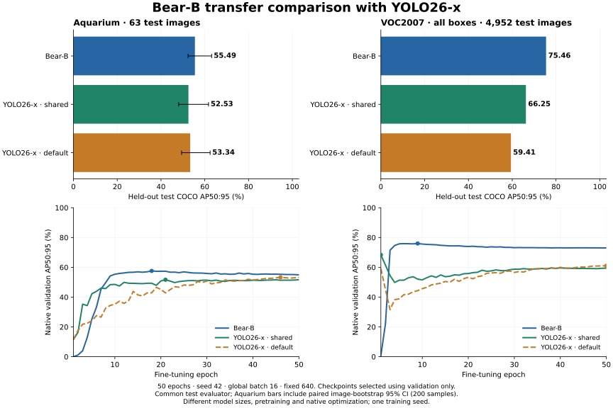

# Aquarium and VOC2007 transfer comparison

Status: all six 50-epoch runs, held-out evaluations and strict checkpoint export completed.

This experiment fine-tunes the original Bear-B COCO FP32 EMA and official
Ultralytics YOLO26-x COCO checkpoint on two more datasets. Neither starts from
the previously fine-tuned African Wildlife checkpoint.

| Dataset | Classes | Training images | Validation images | Held-out test images |
|---|---:|---:|---:|---:|
| Aquarium / ODinW | 7 | 448 | 127 | 63 |
| VOC2007 | 20 | 2,500 | 2,508 | 4,952 |

The original split assignments are preserved. Exact RGB-pixel duplicate removal
keeps test before validation before training: three VOC images are removed,
with no Aquarium duplicates. Two zero-area Aquarium annotations are removed.
Both models consume the same clipped boxes and lossless 640×640 PNG images,
created by PIL bilinear direct resizing. This fixes geometry across models and
differs from standard aspect-preserving letterbox evaluation.

VOC2007 difficult boxes are **included as ordinary positives for both models**.
VOC coordinates are converted from 1-based inclusive boxes to 0-based COCO
boxes. Results are an **all-box COCO-style transfer benchmark**, not official
VOC AP with difficult-object ignoring or the VOC2007 11-point metric.

Each dataset has three 50-epoch runs, seed 42, global batch 16, at 640:

- Bear-B: AdamW 1e-4, staged backbone learning rates 2.048e-6 to 5e-6,
  weight decay 1e-4, cosine schedule, three warm-up epochs, horizontal flip 0.5.
  The class heads and denoising class embedding are reset. FP32 master weights,
  FP16 bulk autocast, FP32 decoder and losses are retained.
- YOLO26-x shared: AdamW 1e-4, weight decay 1e-4, cosine schedule, three warm-up
  epochs, horizontal flip 0.5; mosaic, color jitter and geometric jitter disabled.
- YOLO26-x native: the same dataset, seed, batch and epoch budget with standard
  Ultralytics augmentation and automatic optimizer. Actual resolved settings
  are preserved with the experiment evidence.

Each run uses two RTX 5090 GPUs. Native trainer differences remain, including
normalization, losses, EMA, warm-up floors, gradient clipping and classifier
transfer. Bear's backbone has DINOv3 representation pretraining; official
YOLO26-x has Objects365→COCO detection training. This is not a matched-pretraining
or matched-parameter architecture ablation. Bear-B is about 1.9× larger.

Every checkpoint is selected by its own native validation AP50:95. YOLO recipe
selection also uses validation only. Final predictions use a common
`faster_coco_eval.COCOeval_faster` evaluator, 101 recall points,
`maxDets=[1,10,100]`, up to 300 predictions per image, and no test augmentation.
YOLO uses its one-to-many/NMS accuracy path. The small Aquarium test set gets
200 paired image-bootstrap samples; those intervals describe image-sampling
uncertainty conditional on the trained models, not training-seed variability.

Sources: [Aquarium dataset and CC BY 4.0 attribution](https://universe.roboflow.com/brad-dwyer/aquarium-combined),
[ODinW mirror](https://huggingface.co/GLIPModel/GLIP/tree/main/odinw_35),
[VOC dataset](https://www.robots.ox.ac.uk/~vgg/projects/pascal/VOC/voc2007/),
[Ultralytics implementation](https://github.com/ultralytics/ultralytics).

Reproduction tools are `prepare_transfer_data.py`, `train_transfer_yolo.py`,
`run_transfer_experiment.py`, `summarize_transfer.py` and `plot_transfer_suite.py`
under `tools/benchmarks`. Training manifests retain archive SHA256 values,
removed annotations and duplicates; evaluation retains raw predictions and
per-epoch histories. Final weights use plain `.pt` files.

## Measured held-out test results

| Dataset | Bear-B | Validation-selected YOLO26-x | Bear minus YOLO |
|---|---:|---:|---:|
| Aquarium | 55.49 | 53.34 (native) | +2.15 |
| VOC2007 · all boxes | 75.46 | 66.25 (shared) | +9.21 |

All values are percentages; differences are AP points. The YOLO recipe in this summary is selected on validation, before comparing test scores.

| Dataset | Model / recipe | Selected epoch | Test AP50:95 | Test AP50 | Test AP75 |
|---|---|---:|---:|---:|---:|
| Aquarium | Bear-B | 18 | 55.49 | 84.34 | 63.10 |
| Aquarium | YOLO26-x shared | 21 | 52.53 | 82.57 | 59.08 |
| Aquarium | YOLO26-x native | 46 | 53.34 | 85.38 | 58.34 |
| VOC2007 · all boxes | Bear-B | 9 | 75.46 | 92.09 | 82.13 |
| VOC2007 · all boxes | YOLO26-x shared | 1 | 66.25 | 84.30 | 73.54 |
| VOC2007 · all boxes | YOLO26-x native | 50 | 59.41 | 78.92 | 65.10 |

Aquarium: validation selects **YOLO26-x native** among the two YOLO recipes. Bear-B scores **55.49**, versus **53.34** test AP50:95 (+2.15 points).

The paired Aquarium image-bootstrap 95% interval for this difference is **-0.85 to +5.75 AP points**. It reflects this small test set conditional on the trained checkpoints.

VOC2007 · all boxes: validation selects **YOLO26-x shared** among the two YOLO recipes. Bear-B scores **75.46**, versus **66.25** test AP50:95 (+9.21 points).

| Dataset | Model / recipe | Small AP | Medium AP | Large AP |
|---|---|---:|---:|---:|
| Aquarium | Bear-B | 30.36 | 48.96 | 75.67 |
| Aquarium | YOLO26-x shared | 31.84 | 48.13 | 68.98 |
| Aquarium | YOLO26-x native | 35.55 | 49.18 | 68.64 |
| VOC2007 · all boxes | Bear-B | 24.57 | 53.81 | 82.07 |
| VOC2007 · all boxes | YOLO26-x shared | 18.15 | 42.76 | 72.62 |
| VOC2007 · all boxes | YOLO26-x native | 12.51 | 34.15 | 66.16 |

These results compare the released checkpoints and these recipes. They do not isolate architecture quality, fully tuned optima, compute efficiency or training-seed variability. No GPU latency advantage is claimed. Inspect convergence at the 50-epoch boundary in the curves.

[Full recorded evidence](../../validation/benchmarks/additional-transfer-20261114/) includes native training configurations, initialization hashes, per-epoch validation histories, common evaluator reports, per-class AP, archive hashes and checkpoint hashes. Raw test predictions and full optimizer checkpoints are retained on the training machine.
