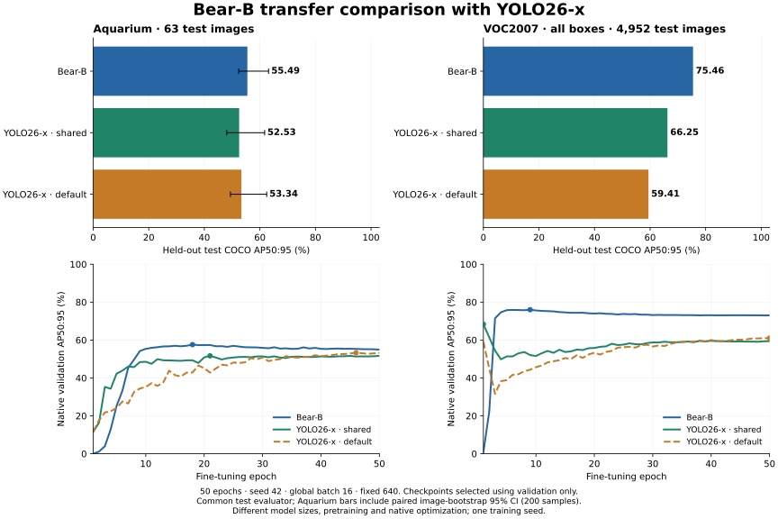

# Aquarium 和 VOC2007 微调对比

六组实验均完成 50 个 epoch。固定输入 640、全局 batch 16、随机种子 42；每个模型使用各自验证集 AP50:95 最佳的 EMA 权重，在独立测试集上统一计算 COCO bbox AP。

| Dataset | Bear-B | Validation-selected YOLO26-x | Bear minus YOLO |
|---|---:|---:|---:|
| Aquarium | 55.49 | 53.34 (native) | +2.15 |
| VOC2007 · all boxes | 75.46 | 66.25 (shared) | +9.21 |

| Dataset | Model / recipe | Selected epoch | Test AP50:95 | Test AP50 | Test AP75 |
|---|---|---:|---:|---:|---:|
| Aquarium | Bear-B | 18 | 55.49 | 84.34 | 63.10 |
| Aquarium | YOLO26-x shared | 21 | 52.53 | 82.57 | 59.08 |
| Aquarium | YOLO26-x native | 46 | 53.34 | 85.38 | 58.34 |
| VOC2007 · all boxes | Bear-B | 9 | 75.46 | 92.09 | 82.13 |
| VOC2007 · all boxes | YOLO26-x shared | 1 | 66.25 | 84.30 | 73.54 |
| VOC2007 · all boxes | YOLO26-x native | 50 | 59.41 | 78.92 | 65.10 |

以上 AP 为百分数，差值为百分点；YOLO 的 shared/native 配方只按验证集选择，不按测试集挑选。Aquarium 为 448/127/63 张训练/验证/测试图像；VOC2007 为 2500/2508/4952 张。清除了 3 张 VOC 精确重复图片和 2 个 Aquarium 零面积标注；两模型共享相同图片和有效标注。

**VOC difficult 标注在两模型中均作为普通正样本保留，因此是全标注 COCO 风格 AP，不是官方 VOC difficult 忽略规则下的 AP，也不是 VOC2007 的 11 点 AP。**

Bear 使用 DINOv3 预训练骨干及 COCO 检测权重，YOLO26-x 使用官方 Objects365→COCO 权重。两者参数量、分类头迁移、骨干学习率、损失和优化实现不同，不能据此把差异完全归因于架构。只使用一个训练种子；Aquarium 的 200 次配对图像 bootstrap 区间不代表训练随机性的区间。本实验只比较精度，没有测量推理延迟优势。

[完整英文协议与分析](MULTIDATA_TRANSFER.md) · [原始统计与配置](../../validation/benchmarks/additional-transfer-20261114/)
