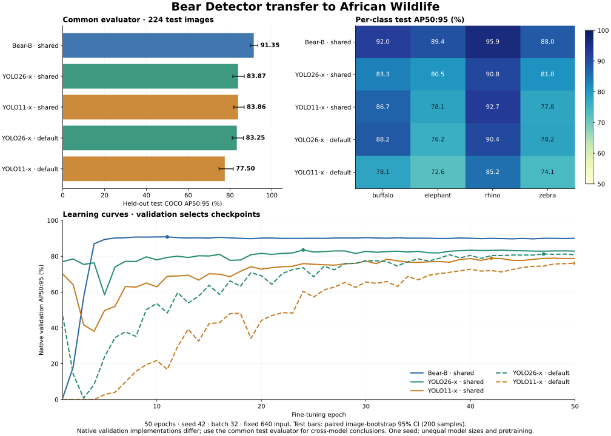

# African Wildlife transfer benchmark

[English](WILDLIFE_TRANSFER.md) | [简体中文](WILDLIFE_TRANSFER.zh-CN.md)

This experiment fine-tunes the released Bear-B COCO checkpoint on a small four-class dataset and compares it with official Ultralytics YOLO26-x and YOLO11-x checkpoints. It is a transfer-learning experiment, separate from the COCO leaderboard comparison. Results apply to these checkpoints and training recipes; they do not isolate architecture quality.

## Results



| Model | Recipe | Selected epoch | Test AP50:95 | 95% image-bootstrap CI | Test AP50 | Test AP75 |
|---|---|---:|---:|---|---:|---:|
| Bear-B | Shared weak augmentation | 11 | 91.35 | 89.73–93.35 | 99.51 | 95.71 |
| YOLO26-x | Shared weak augmentation | 24 | 83.87 | 81.32–86.82 | 96.61 | 92.00 |
| YOLO11-x | Shared weak augmentation | 42 | 83.86 | 81.82–86.78 | 97.01 | 89.98 |
| YOLO26-x | Ultralytics defaults | 47 | 83.25 | 81.06–86.38 | 95.84 | 92.38 |
| YOLO11-x | Ultralytics defaults | 50 | 77.50 | 74.71–81.57 | 91.97 | 86.68 |

All AP values are percentages. Intervals are conditional on these trained checkpoints; all five runs completed 50 epochs. Checkpoints are selected by validation, not by the test numbers in this table. The shared recipe has the higher validation score for both YOLO families.

| Model / recipe | Buffalo AP | Elephant AP | Rhino AP | Zebra AP |
|---|---:|---:|---:|---:|
| Bear-B | 92.03 | 89.42 | 95.95 | 88.01 |
| YOLO26-x | 83.27 | 80.47 | 90.81 | 80.95 |
| YOLO11-x | 86.74 | 78.14 | 92.73 | 77.84 |
| YOLO26-x native | 88.17 | 76.17 | 90.45 | 78.21 |
| YOLO11-x native | 78.07 | 72.63 | 85.21 | 74.07 |

## Performance analysis

Bear-B leads the shared-recipe YOLO26-x by **7.48 AP points** and YOLO11-x by **7.49 points**. The paired 95% intervals for these differences are **+5.39 to +9.69** and **+5.36 to +9.37** points. The observed advantage is consistent under image resampling for this test set; it is not a measurement of training-seed variability or an architecture-only effect.

The AP50 gaps are smaller: +2.90 and +2.50 points. The larger gap averaged over stricter IoUs suggests that localization quality contributes to the result. Medium-object AP is 78.50 for Bear, versus52.28/51.40 for the shared YOLO runs; large-object AP is92.12 versus85.27/85.17. However, there are only **27 medium and344 large objects**, and **zero COCO-small objects** after the fixed640 resize. Small-object AP is therefore undefined, not zero; this experiment provides no evidence about small-object accuracy. Raw evaluator reports retain their undefined sentinel as -100; the summary JSON represents it as null.

Bear's best validation checkpoint is epoch11, with no later improvement in the remaining39 epochs. This supports early convergence on this small task with the chosen initialization and recipe. The shared YOLO checkpoints are selected at epochs24/42. Standard-recipe YOLO scores83.25/77.50 on test, versus83.87/83.86 for the shared recipe; the default YOLO11 run is still best at epoch50, so a longer budget could change its result. These runs do not establish each model's fully tuned optimum.

Bear's unfused training model is **111.95M parameters**, versus**58.82M** for YOLO26-x and**56.88M** for YOLO11-x: about1.90×/1.97× as many. Different representation pretraining, classifier initialization and backbone learning-rate schedules remain confounders. Strong pretrained features are a plausible contributor, but this experiment does not isolate their effect. We measured accuracy here; this transfer experiment does not establish a latency, memory or parameter-efficiency advantage.

## Downloads

[Release: all five plain .pt weights, config, class map, hashes and raw evaluation evidence](https://github.com/xjn0412/bear-detector/releases/tag/wildlife-transfer-20261114).

[Bear-B original FP32 EMA ·448.55 MB](https://github.com/xjn0412/bear-detector/releases/download/wildlife-transfer-20261114/bear-b-wildlife-ema.pt) · [Four-class config](https://github.com/xjn0412/bear-detector/releases/download/wildlife-transfer-20261114/bear-b-wildlife.yml) · [Class map](https://github.com/xjn0412/bear-detector/releases/download/wildlife-transfer-20261114/classes.json).

The Bear release reloads strictly and preserves every selected EMA tensor exactly, including FP32 precision. It is an inference/further-fine-tuning checkpoint; optimizer/scaler resume state is retained on the training machine, not included in this download. Keep the full decoder FP32 when using AMP. These wildlife weights detect four classes and are separate from the80-class COCO releases.

## Dataset and split audit

The [Ultralytics African Wildlife dataset](https://docs.ultralytics.com/datasets/detect/african-wildlife/) has buffalo, elephant, rhino and zebra labels. The downloaded archive originally contained 1,052 train, 225 validation and 227 test images. We removed 41 exact RGB-pixel duplicates, retaining test before validation before training when copies crossed splits.

| Split | Original images | Audited images | Bounding boxes |
|---|---:|---:|---:|
| Train | 1,052 | 1,017 | 1,873 |
| Validation | 225 | 222 | 376 |
| Test | 227 | 224 | 371 |

The audit removes exact copies within and across splits. It does not detect all near duplicates or prove that the images were absent from upstream pretraining. The archive hash and every removed copy are recorded in the [dataset manifest](../../validation/benchmarks/wildlife-20261114/dataset-manifest.json).

Every image is decoded to RGB, resized directly to 640×640 with PIL bilinear interpolation, and saved losslessly as PNG. The same generated images, clipped boxes and class order are consumed by all trainers. This deliberately fixes the geometry; these scores should not be mixed with results using the unmodified dataset and letterbox preprocessing.

## Training and model selection

All runs use 50 epochs, seed 42, global batch 32 and the same audited splits. Early stopping is disabled. Each trainer selects its best EMA checkpoint using validation mAP50:95. Test labels are not used to choose an epoch, recipe or hyperparameter. Native validation metrics are retained for the learning curves; final cross-model comparisons use one common COCO evaluator.

The primary shared recipe uses AdamW with base learning rate 0.0001, weight decay 0.0001, three warm-up epochs, cosine decay to 0.1× the base rate, and horizontal flip probability 0.5. Mosaic, mixup, copy-paste, color jitter and geometric jitter are disabled. Both data loaders retain the final incomplete batch. Distributed samplers may pad a few samples to divide the split between ranks.

There are model-specific differences:

- Bear uses its released fine-tuning implementation: FP32 master weights, FP16 autocast for backbone/context/neck, FP32 decoder and losses, gradient clipping 0.1, and staged backbone learning rates of 2.048e-6 to 5e-6. The new detector layers use the 1e-4 base rate. All four classifier rows and the denoising class embedding are reset.
- Ultralytics uses its native normalization, losses, EMA, parameter grouping and gradient clipping. Its minimum warm-up length is 100 iterations, versus Bear's 96. The installed version remaps the pretrained elephant and zebra classifier rows by name; buffalo and rhino rows are new. Both YOLO models use the default one-to-many/NMS accuracy path for validation and final prediction. YOLO26 also trains its one-to-one branch; the NMS-free inference mode is not selected in this experiment.
- Bear uses four RTX 5090 GPUs; each YOLO run uses two. This equalizes the global batch and epoch budget, not GPU-hours or wall-clock time. No training-speed ranking is inferred from these runs.

A secondary baseline trains each YOLO family with the standard Ultralytics augmentation and automatic optimizer, retaining the same data, 640 input, seed, batch and 50-epoch budget. This gives each YOLO family two recipes versus one for Bear. These additional runs are reported explicitly, not merged with the shared recipe. In this version, automatic optimization selected AdamW at0.00125 with weight decay0.0005; default `nbs=64` uses approximately two-step gradient accumulation at global batch32. Standard augmentation includes mosaic1.0 (closed for the last10 epochs), scale0.5, translate0.1 and HSV jitter. These are package defaults, not a reproduction of the upstream full COCO pretraining recipe.

## Initialization and scope

| Model | Starting checkpoint | Upstream training distinction |
|---|---|---|
| Bear-B | Released original FP32 COCO EMA | COCO detector training; DINOv3-pretrained ConvNeXt-B backbone |
| YOLO26-x | Official `yolo26x.pt` | [Objects365 pretraining followed by COCO](https://docs.ultralytics.com/guides/yolo26-training-recipe); additional detection data |
| YOLO11-x | Official `yolo11x.pt` | Released COCO checkpoint; the full upstream pretraining corpus is not independently audited here |

The project does not claim that all starting weights were trained only on COCO. The earlier COCO-only comparison refers to **detection training data**, with external backbone pretraining separately disclosed. This experiment adds African Wildlife fine-tuning for all models and does not replace the released COCO weights.

## Common evaluation

Validation-selected checkpoints generate detections on the same 224 held-out test images. We evaluate the exported boxes with `faster_coco_eval.COCOeval_faster`, IoU thresholds 0.50:0.95, 101 recall points, and standard `maxDets=[1,10,100]`. Each detector may return up to 300 detections per image. YOLO export uses confidence threshold 1e-5, IoU threshold 0.7 where NMS applies, no test augmentation, and FP32 inference; Bear uses the validated AMP-bulk/FP32-decoder path. No confidence threshold is tuned on test results.

The 95% intervals use 200 paired image-bootstrap samples with seed 42, resampling test images with replacement and recomputing COCO AP. They describe test-sample uncertainty conditional on the trained checkpoints. They do not measure variation across training seeds. This is a single-seed, small-test-set experiment, not a broad detector ranking or a matched-parameter ablation.

## Reproduction and evidence

The code uses [Ultralytics' official implementation](https://github.com/ultralytics/ultralytics). Install Ultralytics 8.4.212 in a compatible PyTorch environment; the experiment used PyTorch 2.14.1+cu130 and RTX 5090 GPUs. Keep dependencies isolated when reproducing an existing training environment.

```bash
python tools/benchmarks/prepare_wildlife.py --root /work/wildlife
python tools/prepare_finetune.py \
  --config configs/B.yml --checkpoint /work/weights/bear-b-coco-ema.pt \
  --train-json /work/wildlife/data640/train.json \
  --val-json /work/wildlife/data640/val.json \
  --train-images /work/wildlife/data640/images/train \
  --val-images /work/wildlife/data640/images/val \
  --output /work/wildlife/run_bear --epochs 50 --batch 32 --lr 0.0001
# Copy the recorded experiment config over run_bear/config.yml before training.
cp validation/benchmarks/wildlife-20261114/bear-config.yml /work/wildlife/run_bear/config.yml
CUDA_VISIBLE_DEVICES=0,1,2,3 python -m torch.distributed.run \
  --standalone --nproc_per_node=4 -- tools/train_custom.py --run /work/wildlife/run_bear
CUDA_VISIBLE_DEVICES=4,5 python tools/benchmarks/train_wildlife_yolo.py \
  --root /work/wildlife --model yolo26x
CUDA_VISIBLE_DEVICES=6,7 python tools/benchmarks/train_wildlife_yolo.py \
  --root /work/wildlife --model yolo11x
```

Place the official YOLO checkpoint files at `/work/wildlife/yolo26x.pt` and `/work/wildlife/yolo11x.pt`; the two YOLO scripts intentionally load those local files. For the secondary runs use `train_wildlife_yolo_native.py` with the same arguments after the shared runs finish. The recorded Bear config uses explicit COCO annotations in `/work/wildlife/data640`; update the `/work/wildlife` prefix consistently if using another root.

Evaluation helpers are [YOLO prediction export](../../tools/benchmarks/evaluate_wildlife_yolo.py), [Bear deployment validation](../../tools/validate_deployment.py), and [common metrics/bootstrap](../../tools/benchmarks/summarize_wildlife.py). Full configurations, initialization hash, epoch histories, common evaluator output and checkpoint hashes are stored under [the experiment evidence directory](../../validation/benchmarks/wildlife-20261114/).
