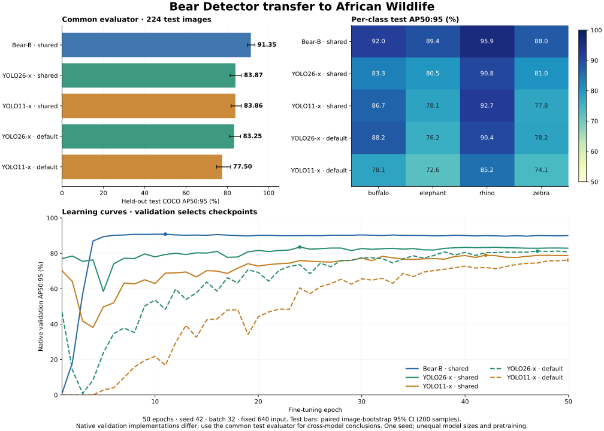

# African Wildlife 小数据集微调比较

[English](WILDLIFE_TRANSFER.md) | [简体中文](WILDLIFE_TRANSFER.zh-CN.md)

本实验从已发布的 Bear-B COCO 原始 FP32 EMA 权重继续微调，比较官方 Ultralytics YOLO26-x、YOLO11-x 在四类动物检测上的效果。这是独立的小数据集迁移实验，与 COCO 排行榜比较分开。结果针对这些权重和训练配方，不能单独归因于架构。

## 结果

| 模型 | 配方 | 选中epoch | 测试AP50:95 | 95%图片bootstrap区间 | 测试AP50 | 测试AP75 |
|---|---|---:|---:|---|---:|---:|
| Bear-B | 共同弱增强 | 11 | 91.35 | 89.73–93.35 | 99.51 | 95.71 |
| YOLO26-x | 共同弱增强 | 24 | 83.87 | 81.32–86.82 | 96.61 | 92.00 |
| YOLO11-x | 共同弱增强 | 42 | 83.86 | 81.82–86.78 | 97.01 | 89.98 |
| YOLO26-x | Ultralytics默认 | 47 | 83.25 | 81.06–86.38 | 95.84 | 92.38 |
| YOLO11-x | Ultralytics默认 | 50 | 77.50 | 74.71–81.57 | 91.97 | 86.68 |

AP均为百分数。五次训练都完成50轮；各权重由验证集选择，没有根据测试表选择epoch。两个YOLO家族都是共同弱增强配方的验证分数更高。区间只针对固定训练权重下的测试样本不确定性。

| Model / recipe | Buffalo AP | Elephant AP | Rhino AP | Zebra AP |
|---|---:|---:|---:|---:|
| Bear-B | 92.03 | 89.42 | 95.95 | 88.01 |
| YOLO26-x | 83.27 | 80.47 | 90.81 | 80.95 |
| YOLO11-x | 86.74 | 78.14 | 92.73 | 77.84 |
| YOLO26-x native | 88.17 | 76.17 | 90.45 | 78.21 |
| YOLO11-x native | 78.07 | 72.63 | 85.21 | 74.07 |

## 性能分析

共同配方下，Bear-B比YOLO26-x高 **7.48个AP点**，比YOLO11-x高 **7.49点**；配对差值的95%区间分别为 **+5.39～+9.69**、**+5.36～+9.37**。说明在这批测试图片的重采样中优势较稳定，但不代表不同训练seed的波动，也不能单独归因于架构。

AP50差距较小，分别为+2.90、+2.50点；更严格IoU下的综合差距更大，提示定位精度可能是优势的一部分。中目标AP为78.50，对比共同配方YOLO的52.28/51.40；大目标AP为92.12，对比85.27/85.17。但固定640缩放后测试集只有 **27个中目标、344个大目标，没有COCO定义的小目标**。因此小目标AP没有定义，不能据此判断小目标性能；原始评估JSON中的-100是未定义哨兵值，汇总JSON改用null表示。

Bear最佳验证权重在第11轮，之后39轮没有提升，说明当前初始化和配方在该小任务上较早收敛。共同配方YOLO分别选中24/42轮。默认配方测试AP为83.25/77.50，低于共同弱增强的83.87/83.86；其中默认YOLO11到第50轮仍是最佳，延长预算可能改变结果。这些实验没有证明各模型经过充分调参后的上限。

Bear未融合训练模型参数 **111.95M**，YOLO26-x为 **58.82M**，YOLO11-x为 **56.88M**，约1.90/1.97倍。表示预训练、分类头初始化和backbone学习率策略也不同。强预训练特征可能有帮助，但本实验没有隔离该因素。这里测量的是精度，没有建立延迟、显存或参数效率优势。

## 下载

[全部五个原生.pt权重、配置、类别、哈希与原始评估证据](https://github.com/xjn0412/bear-detector/releases/tag/wildlife-transfer-20261114)。

[Bear-B原始FP32 EMA ·448.55 MB](https://github.com/xjn0412/bear-detector/releases/download/wildlife-transfer-20261114/bear-b-wildlife-ema.pt) · [四类配置](https://github.com/xjn0412/bear-detector/releases/download/wildlife-transfer-20261114/bear-b-wildlife.yml) · [类别映射](https://github.com/xjn0412/bear-detector/releases/download/wildlife-transfer-20261114/classes.json)。

Bear发布权重已严格重载，并逐张量验证与选中EMA完全一致，保留FP32。这是推理或后续微调初始化权重，不含优化器/scaler续训状态；完整续训权重仍保留在训练机器。使用AMP时保持整个decoder为FP32。这套四类动物权重与原80类COCO发布权重分开。

## 数据与划分审计

使用 [Ultralytics African Wildlife](https://docs.ultralytics.com/datasets/detect/african-wildlife/)：buffalo（水牛）、elephant（大象）、rhino（犀牛）、zebra（斑马）。原压缩包含 1,052 张训练、225 张验证、227 张测试图片。按解码后 RGB 像素去重，发现并移除 41 张重复图片；跨划分重复时优先保留测试，其次验证，最后训练。

| 划分 | 原始图片 | 去重后图片 | 标注框 |
|---|---:|---:|---:|
| 训练 | 1,052 | 1,017 | 1,873 |
| 验证 | 225 | 222 | 376 |
| 测试 | 227 | 224 | 371 |

本次审计移除完全相同的图片，不保证排除近似图片，也不能证明图片从未出现在上游预训练数据中。[数据清单](../../validation/benchmarks/wildlife-20261114/dataset-manifest.json)记录压缩包 SHA256 和每一张被移除的图片。

所有图片统一解码为 RGB，经 PIL 双线性直接缩放到 640×640，再保存为无损 PNG。各模型使用同一批图片、裁剪到图像范围内的框以及相同类别顺序。该处理固定了几何变换，因此不能与原图加 letterbox 的其他实验直接混合比较。

## 训练与选择规则

各次训练均为 50 epoch、seed 42、全局 batch 32，关闭早停。各训练器根据验证集 mAP50:95 选择最佳 EMA 权重；测试集不用于选择 epoch、配方或超参数。学习曲线保留各训练器的原生验证指标，最终比较使用统一 COCO 评估器。

主要比较采用共同的弱增强配方：AdamW，基础学习率 0.0001，weight decay 0.0001，约 3 epoch warm-up，余弦下降到 0.1 倍；仅水平翻转概率 0.5，关闭 mosaic、mixup、copy-paste、颜色和几何扰动。保留最后一个不足 batch 的批次；DDP 为整除 GPU 数可能填充少量重复样本。

仍存在以下模型相关差异：

- Bear 保持已发布微调实现：主权重 FP32，backbone/context/neck 使用 FP16 autocast，完整 decoder 和损失 FP32，梯度裁剪 0.1。backbone 分阶段学习率为 2.048e-6～5e-6，新模块基础学习率 1e-4。全部分类头和去噪类别 embedding 重新初始化。
- YOLO 使用原生归一化、损失、EMA、参数分组和梯度裁剪。最少 warm-up 为 100 iteration，Bear 为 96。当前 Ultralytics 按名称保留 elephant、zebra 两类的预训练分类行，buffalo、rhino 为新类别。两种 YOLO 均使用默认的 one-to-many/NMS 精度路径评估；本实验未选择 YOLO26 的 NMS-free 推理模式。
- Bear 使用 4 张 RTX 5090，每次 YOLO 训练使用 2 张。全局 batch 和 epoch 相同，不代表 GPU 时间相同，因此不据此排名训练速度。

额外为每个 YOLO 家族运行一次标准 Ultralytics 配方，保留默认数据增强和自动优化器。同样使用上述数据、640 输入、seed、batch 和 50 epoch。这使每个 YOLO 家族有两次配方试验，而 Bear 只有一次；额外结果单独列出。当前版本自动选择AdamW、学习率0.00125、weight decay0.0005；默认`nbs=64`在全局batch32时通常每两步累积更新。增强含mosaic1.0（最后10轮关闭）、scale0.5、translate0.1和HSV扰动。这是软件包默认配方，不是重现上游完整COCO预训练配方。

## 初始权重与公平性边界

| 模型 | 初始权重 | 上游数据区别 |
|---|---|---|
| Bear-B | 原始 FP32 COCO EMA | 检测训练仅 COCO；backbone 为 DINOv3 预训练 ConvNeXt-B |
| YOLO26-x | 官方 `yolo26x.pt` | Objects365 预训练后再训练 COCO，包含额外检测数据 |
| YOLO11-x | 官方 `yolo11x.pt` | 已发布 COCO 权重；未独立审计其全部上游预训练语料 |

不能称所有初始权重都只训练过 COCO。之前的 COCO-only 比较限定的是**检测训练数据**，backbone 预训练另行披露。本次各模型再微调 African Wildlife，不覆盖已发布的 COCO 权重。YOLO26 上游流程见[官方训练配方](https://docs.ultralytics.com/guides/yolo26-training-recipe)。

## 统一评估与限制

在同一批 224 张独立测试图片上导出预测框，使用 `faster_coco_eval.COCOeval_faster`，IoU 0.50:0.95、101 个召回点、标准 `maxDets=[1,10,100]`。各模型最多输出 300 个框；YOLO 导出阈值 1e-5，NMS IoU 0.7，无测试增强，FP32 推理；Bear 使用已验证的 AMP 主干加 FP32 decoder 路径。不根据测试结果调整阈值。

95% 区间由 seed 42 的 200 次配对图片 bootstrap 得到：每次有放回地重采样测试图片并重新计算 AP。它只反映固定训练权重下的测试样本不确定性，不包含不同训练 seed 的波动。这是单 seed、小测试集实验，不是广泛的检测器排名，也不是相同参数量的架构消融。

## 复现与证据

使用 [Ultralytics 官方仓库](https://github.com/ultralytics/ultralytics)实现，版本 8.4.212；实测环境为 PyTorch 2.14.1+cu130、RTX 5090。完整命令见[英文文档](WILDLIFE_TRANSFER.md#reproduction-and-evidence)。

[证据目录](../../validation/benchmarks/wildlife-20261114/)包含数据审计、Bear 配置、初始化哈希、逐 epoch 记录、YOLO 配置、统一评估结果及权重哈希。[准备数据](../../tools/benchmarks/prepare_wildlife.py)、[YOLO 弱增强训练](../../tools/benchmarks/train_wildlife_yolo.py)、[YOLO 默认配方](../../tools/benchmarks/train_wildlife_yolo_native.py)、[统一汇总与 bootstrap](../../tools/benchmarks/summarize_wildlife.py)均保留为可复用脚本。
