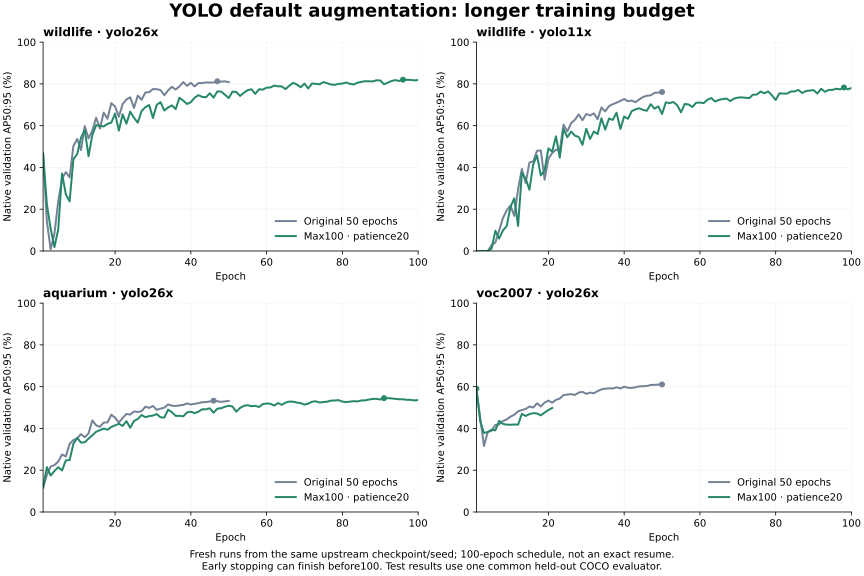

# YOLO default-augmentation runs with a longer budget

Status: all four longer-budget runs and common held-out test evaluations completed.

Four default-augmentation runs are rerun with an epoch limit of100 and early
stopping after20 epochs without validation improvement: YOLO26-x on African
Wildlife, Aquarium and VOC2007, and YOLO11-x on African Wildlife.

The completed50-epoch runs remain immutable. Their saved best/last checkpoints
were stripped of optimizer and separate EMA state, so these are fresh runs
from the same original COCO checkpoints, seed42, audited data splits, 640 input,
task-specific batch sizes and default augmentation. The100-epoch schedule also
moves the normal final10-epoch mosaic-closing period. Early stopping may finish
a run before100 epochs. This is a separately labeled longer-budget experiment,
not an exact continuation of the original50-epoch trajectory.

The actual AdamW choice and learning rate of the prior auto-optimizer run are
pinned explicitly, with beta1=.9 and zero bias warm-up LR. This avoids an
automatic optimizer change caused by the larger planned iteration count.
Original effective settings are read from checkpoint metadata; the initial
`args.yaml` records `optimizer=auto` before resolution and is not authoritative
for its effective optimizer/LR. The installed Ultralytics version is8.4.212.

Each new run retains full last/best resume checkpoints before the standard
final optimizer stripping, plus periodic checkpoints every10 epochs. Validation
alone selects best.pt and determines early stopping; that checkpoint is then
evaluated once on the existing held-out test split with the common COCO bbox
evaluator. No test score chooses an epoch, recipe or learning rate.

The main table will continue to show the original50-epoch comparison. Longer
YOLO runs will be shown separately with their actual completed/selected epochs.
Bear models remain at50 epochs. Differences in training budget, model size,
pretraining and native optimization are disclosed.

During setup an inherited `save_dir` caused a collision with two completed run
folders. The original selected model files were restored from archived release
copies and their SHA256 values verified. All50 epochs of metrics were rebuilt
from those checkpoints' complete saved training histories and checked against
the prior recorded curves. The non-selected Wildlife YOLO26-x epoch50 checkpoint
could not be restored; its selected epoch47 checkpoint and original held-out
test reports are intact. VOC's selected/final epoch50 model was restored.
New runs have an explicit output directory and a trainer guard that rejects
paths outside the new experiment root before initializing training.

## Measured results

| Dataset / model | Original50 AP | Max100 AP | Actual epochs | Selected epoch | AP difference |
|---|---:|---:|---:|---:|---:|
| wildlife / yolo26x | 83.25 | 82.09 | 100 | 96 | -1.15 |
| wildlife / yolo11x | 77.50 | 79.66 | 100 | 98 | +2.17 |
| aquarium / yolo26x | 53.34 | 54.63 | 100 | 91 | +1.29 |
| voc2007 / yolo26x | 59.41 | 57.27 | 21 | 1 | -2.14 |

AP values are test percentages; differences are AP points. Actual completed epochs are reported explicitly, including early-stopped runs. The100-epoch schedule and late mosaic-closing point differ from the original50-epoch schedule.

| Dataset | Bear-B50 | Bear-L50 | YOLO26x default50 | YOLO26x max100 |
|---|---:|---:|---:|---:|
| wildlife | 91.35 | 91.54 | 83.25 | 82.09 |
| aquarium | 55.49 | 58.44 | 53.34 | 54.63 |
| voc2007 | 75.46 | 76.30 | 59.41 | 57.27 |

This is a longer-budget comparison with Bear fixed at50 epochs. One seed, unequal model sizes and pretraining remain limitations. No test labels selected an epoch or optimizer. VOC difficult boxes are ordinary positives and use COCO AP rather than official VOC AP.

[Full per-class/size metrics, epoch histories, resolved settings and hashes](../../validation/benchmarks/yolo-long-budget-20261114/).
