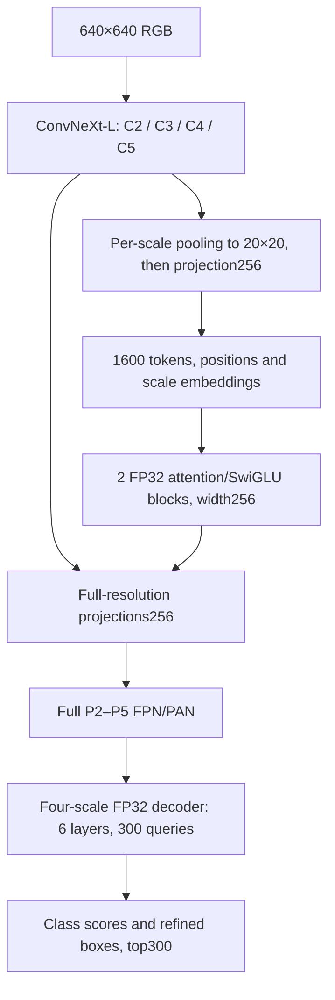

# Bear Detector v2

V2 is an experimental development branch of [Bear Detector](https://github.com/xjn0412/bear-detector). It retains upstream DEIMv2/DINOv3 attribution and license terms. V1 configurations remain available; v1 detector checkpoints are not compatible with the new v2 architecture. No trained v2 detector or v2 AP result is published yet.

## Four scales from backbone to head

At 640, ConvNeXt-L emits C2/C3/C4/C5 with channels 192/384/768/1536 and spatial sizes 160/80/40/20. Each full-resolution feature receives a separate FP32 1×1 projection to 256 channels. A second branch pools each raw feature to 20×20 **before** its own FP32 projection and concatenates 1,600 tokens. Fixed 2D positions and learned scale embeddings identify each token. Two pre-LN, width-256, eight-head SDPA/SwiGLU blocks mix the scales. Each scale's context is resized and added to its full-resolution projection through a channel-wise residual gate initialized to 0.1.

The original v1 C5-only attention and P2→P3 detail shortcut are replaced, not added a second time.



The neck is the existing HybridEncoder extended to four inputs, with three complete top-down fusion blocks and three complete bottom-up fusion blocks. Every scale has width256. The sum-fusion/CSP2 recipe, depth multiplier1.37 and expansion1.25 are retained.

| Neck output | Size | Stride | Decoder samples per head |
|---|---:|---:|---:|
| P2 | 160×160 | 4 | 4 |
| P3 | 80×80 | 8 | 4 |
| P4 | 40×40 | 16 | 2 |
| P5 | 20×20 | 32 | 2 |

All four maps enter query selection and deformable sampling: 34,000 locations. There is no dense global attention over those locations. The initial anchor size is0.025 on P2, preserving v1's0.05/0.10/0.20 on P3/P4/P5. P2 retains its full spatial resolution through the neck.

## Numerical policy

Use FP32 master parameters and optimizer state. The supported `tools/train_v2.py` launcher installs the checked training loop. `--amp auto` tests layer-level FP16 error against FP32 and exercises the complete AMP forward on the first batch. A failed check selects FP32 across DDP ranks. Later nonfinite forwards restore RNG and mutable buffers, retry the same batch in FP32, and retain FP32 for subsequent batches.

The four full-resolution projections, pooled context projections/attention/gated FFNs, context residual additions and the entire decoder execute in FP32 even under outer FP16 autocast. FP32 precision is entered **before** convolution or matrix multiplication, not after an overflow. The v2 decoder removes the upstream FP16-range clamp so infinities cannot be hidden behind saturation. Matching, criterion and raw loss checks stay FP32; invalid losses are never converted to zero. Dynamic GradScaler starts at1024 and unscales before clipping. Skipped optimizer updates do not advance EMA; an epoch with no updates fails.

Underflow may produce finite zeros; an `isfinite` check cannot detect it. FP32 islands protect small context signals, FP32 master weights preserve small updates, and loss scaling reduces FP16 backward underflow in the CNN/neck. First-batch layer comparisons use FP64 norms and a small1e-12 absolute floor to avoid accepting complete loss of a small signal. These are safeguards, not a mathematical guarantee for every dataset or gradient. Use `--amp fp32` if AMP comparisons or training behavior remain unacceptable.

Checked PyTorch inference compares first-input AMP neck features with FP32 (maximum5% relative L2 per scale), checks every input/features/predictions for nonfinite values, and persistently retries in FP32 after a failed numerical check. This first-input comparison does not prove accuracy parity on all later inputs. Never call `model.half()`.

For mixed checkpoint storage, v2 projections, context, gates and decoder retain original FP32 values. Conversion refuses newly nonfinite tensors and any nonzero v2 value rounded to zero. Full FP32 archives are the reference.

The TensorRT exporter protects all four projection scopes, the pooled context, decoder and sensitive normalization/reductions, and fails if required scopes are missing. Static engines do not contain Python fallback. Each trained checkpoint/engine needs held-out AP comparison and stress testing before release; no v2 TensorRT accuracy claim is made.

## Initialize and train

Install the dependencies using the existing [installation guide](../getting-started/INSTALL.md). Check out the v2 branch rather than using an older published Docker image that does not contain v2.

```bash
git clone --branch v2 https://github.com/xjn0412/bear-detector.git
cd bear-detector
python tools/initialize.py --config configs/V2-L.yml --pretrained --output weights/v2-l-initial.pt
torchrun --standalone --nproc_per_node=8 tools/train_v2.py --config configs/V2-L.yml --checkpoint weights/v2-l-initial.pt --amp auto
```

DINOv3 weight access/download must be available. Alternatively use `--backbone-weights /path/to/backbone.safetensors`. Do not initialize v2 using a v1 detector checkpoint. Adjust COCO paths in the YAML before training. Detection supervision remains COCO train2017 only; DINOv3 backbone pretraining uses external data.

Default total training batch is8 (one sample per GPU on8 GPUs), with ConvNeXt gradient checkpointing enabled. The full P2 neck is memory intensive; increase batch only after measuring available headroom with the actual recipe. `--amp fp32` uses more memory. Resume with `--resume runs/coco640_v2_L/last.pth` to restore optimizer/scaler/EMA/precision state, rather than restarting from inference weights.

For custom datasets, initialize a v2 checkpoint and use the existing `prepare_finetune.py` and `train_custom.py` workflow with a V2 config. Until a trained v2 detector exists, this starts detection learning from backbone pretraining rather than a COCO-finetuned v2 detector.

## Verification

```bash
python tests/test_v2.py
python tests/test_compact.py
CUDA_VISIBLE_DEVICES=7 python tools/verify_v2.py --config configs/V2-L.yml --output results/v2-gpu-smoke.json
python tools/profile_model.py --config configs/V2-L.yml --output results/v2-L-profile.json
```

The smoke test uses random initialization, two real synthetic optimizer updates and normal/zero/tiny/large inference inputs. It checks nonzero gradients through the backbone, pooled context, P2 fusion and decoder. Failure-path tests inject AMP overflow and finite signal loss, verify persistent FP32 fallback, RNG/buffer restoration, and tiny FP32 gradients. They do not establish dataset accuracy or convergence.

Measured v2-L deployed arithmetic at640 is **783.9922 GFLOPs/image**, with **224.5296M full /223.1572M deployed parameters**. This supersedes the earlier0.80–0.83 TFLOPs estimate. The same [counting scope](../benchmarks/COMPLEXITY.md) is used:2 FLOPs/MAC, attention products and bilinear sampling, excluding normalization/activation/softmax/indexing/memory traffic. V1-L is622.32 GFLOPs, so the increase is about26%. FLOPs do not predict latency.
